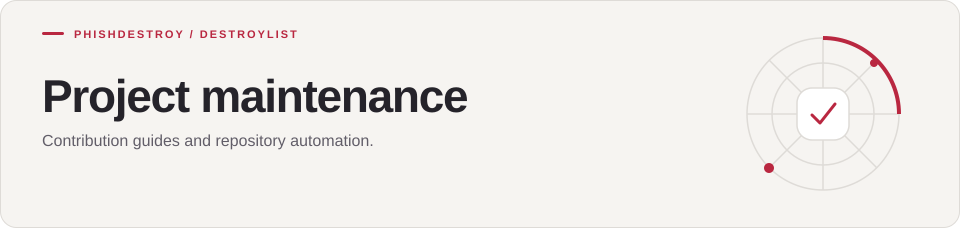

[Destroylist](../README.md) / .github

<h1>
<picture>
  <source media="(max-width: 640px)" srcset="banner-mobile.svg">
  
</picture>
</h1>

Contribution guides and repository automation.

---

| Guide | Purpose |
| --- | --- |
| [Contributing](CONTRIBUTING.md) | Submit changes and report issues |
| [Code of conduct](CODE_OF_CONDUCT.md) | Community expectations |
| [Security](SECURITY.md) | Report vulnerabilities |
| [Issue forms](ISSUE_TEMPLATE/) | Structured reports and requests |
| [Workflows](workflows/) | Automated checks and publishing |
| [Pages](pages/) | Website configuration |
