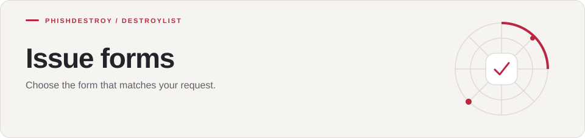

[Destroylist](../../README.md) / [.github](../AUTOMATION.md) / ISSUE_TEMPLATE

<h1>
<picture>
  <source media="(max-width: 640px)" srcset="banner-mobile.svg">
  
</picture>
</h1>

Choose the form that matches your request.

---

[Open an issue](https://github.com/phishdestroy/destroylist/issues/new/choose)

| Form | Purpose |
| --- | --- |
| [Appeal](appeal.yml) | Request review of a listed domain |
| [Blocklist addition](blocklist-addition.yml) | Submit a domain for review |
| [Bug report](bug_report.yml) | Report a problem |
| [Feedback](feedback.yml) | Share a suggestion |
