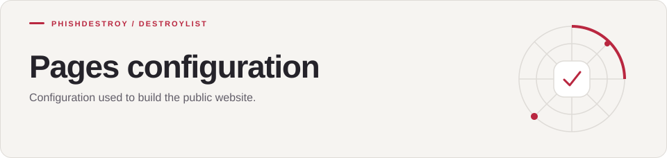

[Destroylist](../../README.md) / [.github](../README.md) / pages

<h1>
<picture>
  <source media="(max-width: 640px)" srcset="banner-mobile.svg">
  
</picture>
</h1>

Configuration used to build the public website.

---

[_config.yml](_config.yml) is used by the [Pages workflow](../workflows/pages.yml).

The website sources live in [scripts/_source](../../scripts/_source/).
