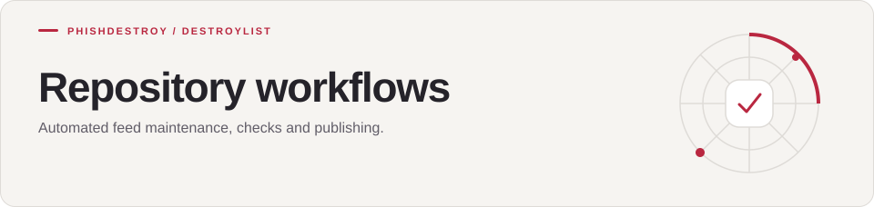

[Destroylist](../../README.md) / [.github](../README.md) / workflows

<h1>
<picture>
  <source media="(max-width: 640px)" srcset="banner-mobile.svg">
  
</picture>
</h1>

Automated feed maintenance, checks and publishing.

---

The YAML files in this directory define the repository automation. Each workflow records its own triggers and schedule.

[View runs](https://github.com/phishdestroy/destroylist/actions) · [Pipeline scripts](../../scripts/)

<b>Automation status</b>

  
  
  
  

