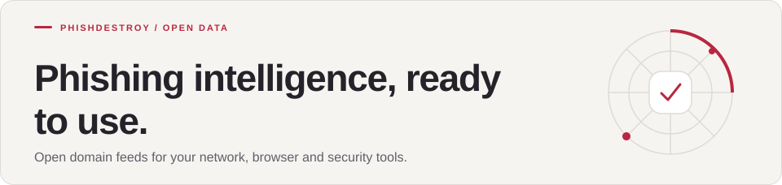

<picture>
  <source media="(max-width: 640px)" srcset="assets/hero-mobile.svg">
  
</picture>

# Destroylist

Phishing and scam domain intelligence by **PhishDestroy**. Choose a curated feed, explore community data or check a domain through the API.

**[Quick start](#quick-start)** · **[Data feeds](#data-feeds)** · **[API](#threat-intelligence-api)** · **[Explore the repository](#explore-the-repository)** · **[Appeals](#appeals-process)**

[Website](https://phishdestroy.io) · [Live dashboard](https://phishdestroy.github.io/destroylist/scripts/) · [MIT license](LICENSE)

## Quick start

For **Pi-hole**, add the Primary Active hosts feed to your blocklist subscriptions:

```text
https://cdn.jsdelivr.net/gh/phishdestroy/destroylist@main/rootlist/formats/primary_active/hosts.txt
```

For **AdGuard Home or uBlock Origin**, use the AdBlock feed:

```text
https://cdn.jsdelivr.net/gh/phishdestroy/destroylist@main/rootlist/formats/primary_active/adblock.txt
```

Primary Active contains the DNS-resolving subset of the curated feed. Choose the full Primary feed when you also want previously listed domains that no longer resolve.

[All formats and downloads](rootlist/formats/) · [Integration guide](docs/INTEGRATIONS.md) · [Raw GitHub mirror](https://raw.githubusercontent.com/phishdestroy/destroylist/main/rootlist/formats/primary_active/hosts.txt)

CDN copies may be cached. If a download fails, retry with backoff or use the raw mirror.

## Data feeds

| Feed | What it contains | Downloads |
| --- | --- | --- |
| **Primary** | Curated phishing and scam domains | [JSON](https://raw.githubusercontent.com/phishdestroy/destroylist/main/list.json) · [TXT](https://raw.githubusercontent.com/phishdestroy/destroylist/main/list.txt) |
| **Primary Active** | Primary domains that resolve through DNS | [JSON](https://raw.githubusercontent.com/phishdestroy/destroylist/main/dns/active_domains.json) · [TXT](https://raw.githubusercontent.com/phishdestroy/destroylist/main/dns/active_domains.txt) |
| **Primary Content** | Primary domains retained by HTTP content checks | [JSON](https://raw.githubusercontent.com/phishdestroy/destroylist/main/dns/content_active.json) · [TXT](https://raw.githubusercontent.com/phishdestroy/destroylist/main/dns/content_active.txt) |
| **Community** | Aggregated public threat feeds | [JSON](https://raw.githubusercontent.com/phishdestroy/destroylist/main/community/blocklist.json) · [TXT](https://raw.githubusercontent.com/phishdestroy/destroylist/main/community/blocklist.txt) |
| **Community Active** | Community domains that resolve through DNS | [JSON](https://raw.githubusercontent.com/phishdestroy/destroylist/main/community/live_blocklist.json) · [TXT](https://raw.githubusercontent.com/phishdestroy/destroylist/main/community/live_blocklist.txt) |
| **Community Content** | Community domains retained by HTTP content checks | [JSON](https://raw.githubusercontent.com/phishdestroy/destroylist/main/community/content_live.json) · [TXT](https://raw.githubusercontent.com/phishdestroy/destroylist/main/community/content_live.txt) |

Community coverage and false positives vary by source. Review the [community policy](community/#policy) before using it for filtering.

<a name="root-lists"></a>

**Need a different shape?** [Root domains](rootlist/) · [Hosts, AdBlock, DNS and Redis formats](rootlist/formats/) · [JSON shards](rootlist/arrays/) · [STIX 2.1](stix/) · [Exclusions](allow/)

<a name="content-verified-feeds"></a>

Content checks can miss cloaked pages. DNS resolution and HTTP checks are observations at a point in time; absence from a feed is not a safety verdict.

## Live Statistics

<table>
  <tr>
    <td align="center" width="33%"><b>Primary</b><br/><br/></td>
    <td align="center" width="33%"><b>Primary Live</b><br/><br/></td>
    <td align="center" width="33%"><b>Primary Content</b><br/><br/></td>
  </tr>
  <tr>
    <td align="center" width="33%"><b>Community</b><br/><br/></td>
    <td align="center" width="33%"><b>Community Live</b><br/><br/></td>
    <td align="center" width="33%"><b>Community Content</b><br/><br/></td>
  </tr>
</table>

<details>
<summary>Additions today, this week and this month</summary>

### Today / Week / Month

<table>
  <tr><th align="left" width="25%">Feed</th><th align="center" width="25%">Today</th><th align="center" width="25%">Week</th><th align="center" width="25%">Month</th></tr>
  <tr><th align="left" scope="row" width="25%">Primary</th><td align="center" width="25%"></td><td align="center" width="25%"></td><td align="center" width="25%"></td></tr>
  <tr><th align="left" scope="row" width="25%">Community</th><td align="center" width="25%"></td><td align="center" width="25%"></td><td align="center" width="25%"></td></tr>
</table>

</details>

<details>
<summary>How these counts work</summary>

Badge values are exact **feed-entry counts**. The API reports normalized unique domains, so its values can be lower after URL, `www` and duplicate normalization. See the machine-readable [`dns/metrics.json`](dns/metrics.json) definitions.

</details>

## Threat intelligence API

Check a domain, search the feeds or submit a bulk request. No API key is required.

```bash
curl --fail-with-body "https://api.destroy.tools/v1/check?domain=example.com"
```

| Task | Endpoint |
| --- | --- |
| Check a domain | `GET /v1/check?domain=` |
| Check up to 500 domains | `POST /v1/check/bulk` |
| Search by keyword | `GET /v1/search?q=` |
| Download a feed | `GET /v1/feed/{list}` |
| Read statistics | `GET /v1/stats` |

[API guide and examples](docs/API.md) · [Current schemas and quotas](https://api.destroy.tools/openapi.json)

## Explore the repository

| Directory | Start here for |
| --- | --- |
| [allow](allow/) | Exclusions and false-positive controls |
| [community](community/) | Aggregated feeds and source policy |
| [dns](dns/) | DNS/content checks and activity metrics |
| [rootlist](rootlist/) | Root domains, tool formats and monthly reports |
| [archives](archives/) | Daily changes and historical snapshots |
| [stix](stix/) | STIX indicators and release downloads |
| [scripts](scripts/) | Pipeline utilities and website sources |
| [docs](docs/) | API, integrations and project background |
| [assets](assets/) | Shared documentation artwork |
| [.github](.github/AUTOMATION.md) | Contribution guides and automation |

## About Destroylist

The project publishes domain intelligence and supports abuse reporting and investigation. Curated and community datasets have different collection paths; their policies are documented alongside the feeds.

<a name="threat-intelligence--automated-remediation-workflow"></a>
<a name="key-info-for-online-fraud-victims"></a>
<a name="use-cases--historical-vault"></a>

[Discovery and reporting](docs/ABOUT.md) · [Information for fraud victims](docs/ABOUT.md#key-info-for-online-fraud-victims) · [Historical records](archives/) · [Monthly reports](rootlist/2026/)

## Appeals process

If a domain is wrongly listed, send the domain and a short explanation. No proof of ownership is required; screenshots and links are optional.

**[Submit an appeal](https://phishdestroy.io/appeals/)** · [Use a GitHub issue](https://github.com/phishdestroy/destroylist/issues/new?template=appeal.yml)

See the [current appeals policy](https://phishdestroy.io/appeals/) for review details. Corrections to the original community source must also be requested from that source.

## Connect with us

[Website](https://phishdestroy.io) · [Telegram](https://t.me/destroy_phish) · [Report bot](https://t.me/PhishDestroy_bot) · [X](https://x.com/Phish_Destroy) · [Mastodon](https://mastodon.social/@phishdestroy)

[Email](mailto:contact@phishdestroy.io) · [Medium](https://phishdestroy.medium.com) · [Ban service](https://ban.destroy.tools)

## Join the fight!

[Report a domain](https://github.com/phishdestroy/destroylist/issues/new?template=blocklist-addition.yml) · [Contribute](.github/CONTRIBUTING.md) · [Report a bug](https://github.com/phishdestroy/destroylist/issues/new?template=bug_report.yml)

## License

[MIT](LICENSE) · [Security policy](.github/SECURITY.md) · [Code of conduct](.github/CODE_OF_CONDUCT.md)
