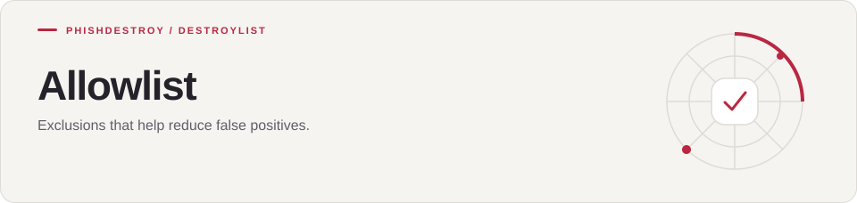

[Destroylist](../README.md) / allow

<h1>
<picture>
  <source media="(max-width: 640px)" srcset="banner-mobile.svg">
  
</picture>
</h1>

Exclusions that help reduce false positives.

[View exclusions](allowlist.json) · [Request a correction](https://phishdestroy.io/appeals/)

---

## Overview

Exact hostnames and explicitly approved suffix patterns used to prevent repeated false-positive listings and clean our published feeds.

It exists for one reason: to stop our own detection from flagging the obvious. Primitive heuristics make mistakes, and this list is where we keep the domains those mistakes keep hitting.

> [!IMPORTANT]
> **This is not verification, endorsement or a safety rating.**
>
> We do not audit anything on this list and we do not vouch for anything on it. A domain being here means our automated detection should not flag it on its own — that is the entire meaning, and there is nothing behind it.
>
> Projects get hacked. Frontends get swapped through a compromised dependency. Domains get abandoned, expire and change hands. Any domain on this list can be serving a drainer right now, and the list will not know.
>
> Check what you are about to sign. Every time.

If a listed domain is compromised, we remove it and record it in the commit.

## Format Rules

- **Exact hostnames**, including individual subdomains (e.g., `example.org` or `trade.example.org`).
- An exact hostname does not whitelist all child hostnames. The cleaner also handles its `www.` form and same-host paths, with exceptions for shared hosting.
- **Approved suffix patterns** begin with a dot. `.paypal.com` covers that hostname and its subdomains; `.microsoft` covers that suffix. New patterns must be explicitly approved in the code.
- Keep entries lowercase. Do not broaden a shared-hosting exclusion to cover unrelated tenants.

## Contents

| File | Description |
|:-----|:------------|
| `allowlist.json` | Exact hostnames and approved suffix patterns used for exclusions |

**Example:**

```json
[
  "binance.com",
  "kraken.com",
  "uniswap.org"
]
```

## Request Addition

Open an issue: [github.com/phishdestroy/destroylist/issues](https://github.com/phishdestroy/destroylist/issues)

Include:
- Project name
- Homepage URL
- Exact hostname(s) to review
- Brief rationale

> [!TIP]
> If your domain is **currently listed** by us, use [Appeals](https://phishdestroy.io/appeals/) instead. It is faster, needs no GitHub account, and auto-approves within 24 hours if no operator gets to it.

## Credits

The initial list came from [SEAL (Security Alliance)](https://github.com/security-alliance/allowlists), and a large part of it is still theirs. Thanks to SEAL for maintaining it in the open so projects like ours can build on top of it instead of starting from nothing.

Entries added by us are our own decisions — any mistakes in them are ours, not SEAL's.

---

[Destroylist](../README.md) · [All feeds](../README.md#data-feeds) · [Appeals](https://phishdestroy.io/appeals/)
