<div align="center">



# Allowlist

**Scanner exclusion list — false-positive control for crypto & Web3**


<p align="center">


</p>


<p align="center">
<a href="https://github.com/phishdestroy/destroylist"></a>
<a href="https://api.destroy.tools"></a>
<a href="https://phishdestroy.io/appeals/"></a>
</p>

</div>

---

## Overview

A list of apex domains our scanner will not add to Destroylist automatically.

It exists for one reason: to stop our own detection from flagging the obvious. Primitive heuristics make mistakes, and this list is where we keep the domains those mistakes keep hitting.

> [!IMPORTANT]
> **This is not verification, endorsement or a safety rating.**
>
> We do not audit anything on this list and we do not vouch for anything on it. A domain being here means our automated detection should not flag it on its own — that is the entire meaning, and there is nothing behind it.
>
> Projects get hacked. Frontends get swapped through a compromised dependency. Domains get abandoned, expire and change hands. Any domain on this list can be serving a drainer right now, and the list will not know.
>
> Check what you are about to sign. Every time.

If a listed domain is compromised, we remove it and record it in the commit.

## Format Rules

- **Apex domains only** (e.g., `example.org`)
- No subdomains
- No paths
- Lowercase only

## Contents

| File | Description |
|:-----|:------------|
| `allowlist.json` | Array of apex domains excluded from detection |

**Example:**

```json
[
  "binance.com",
  "kraken.com",
  "uniswap.org"
]
```

## Request Addition

Open an issue: [github.com/phishdestroy/destroylist/issues](https://github.com/phishdestroy/destroylist/issues)

Include:
- Project name
- Homepage URL
- Apex domain(s)
- Brief rationale

> [!TIP]
> If your domain is **currently listed** by us, use [Appeals](https://phishdestroy.io/appeals/) instead. It is faster, needs no GitHub account, and auto-approves within 48 hours if no operator gets to it.

## Credits

The initial list came from [SEAL (Security Alliance)](https://github.com/security-alliance/allowlists), and a large part of it is still theirs. Thanks to SEAL for maintaining it in the open so projects like ours can build on top of it instead of starting from nothing.

Entries added by us are our own decisions — any mistakes in them are ours, not SEAL's.

---

<div align="center">

[](https://github.com/phishdestroy/destroylist)

</div>
