<div align="center">



**Historical snapshots of the blocklist for research and analysis**


<p align="center">


</p>


<p align="center">
<a href="https://github.com/phishdestroy/destroylist"></a>
<a href="https://github.com/phishdestroy/destroylist/releases/tag/archives"></a>
<a href="https://api.destroy.tools"></a>
</p>

</div>

---

## Structure

```
archives/
├── weekly/        # last 4 weekly snapshots
│   └── YYYY-WXX.json
└── monthly/       # current monthly snapshot
    └── YYYY-MM.json
```

| Directory | Schedule | Pattern | Details |
|:----------|:---------|:--------|:--------|
| [`weekly/`](weekly/) | Every Monday at 01:00 UTC | `YYYY-WXX.json` | ISO 8601 week number |
| [`monthly/`](monthly/) | 1st of each month | `YYYY-MM.json` | Monthly snapshot |

Only the most recent snapshots live in the tree — older ones are rotated
automatically to the permanent
**[`archives` Release](https://github.com/phishdestroy/destroylist/releases/tag/archives)**,
so the repository stays small while nothing is ever deleted.

Daily added/removed diffs (indexed by GitHub code search) live in
[`changes/`](changes/).

## Format

Each snapshot is the full state of both lists at capture time:

```json
{
  "date": "YYYY-MM-DD",
  "primary_count": 188820,
  "community_count": 993697,
  "primary_domains": ["..."],
  "community_domains": ["..."]
}
```

**Check a domain against a historical state:**

```bash
curl -sL https://github.com/phishdestroy/destroylist/releases/download/archives/2026-06.json \
  | jq -r '.primary_domains[]' | grep -x 'suspicious-domain.com'
```

## Use Cases

- Track blocklist growth over time
- Analyze domain lifecycle
- Research phishing trends
- Train ML models on historical data

## Full Archive

For access to the complete historical archive (500K+ domains, 5+ years):

 **[contact@phishdestroy.io](mailto:contact@phishdestroy.io)**

---

<div align="center">

[](https://github.com/phishdestroy/destroylist)

</div>
