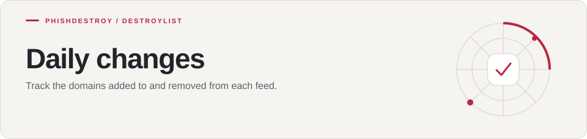

[Destroylist](../../README.md) / [archives](../README.md) / changes

<h1>
<picture>
  <source media="(max-width: 640px)" srcset="banner-mobile.svg">
  
</picture>
</h1>

Track the domains added to and removed from each feed.

[Format](#format) · [Full snapshots](../)

---

## Overview

Every night the **Update Statistics** workflow (`scripts/calculate_stats.py`) compares today's lists with
yesterday's and writes the difference to `YYYY-MM/YYYY-MM-DD.json`. Files are small and never rotated, so
the full history stays in the tree.

> [!TIP]
> These files are indexed by GitHub code search. Search for a domain to see the day it was added or removed:
> [`repo:phishdestroy/destroylist path:archives/changes example.com`](https://github.com/search?q=repo%3Aphishdestroy%2Fdestroylist+path%3Aarchives%2Fchanges+example.com&type=code)

## Format

```json
{
  "date": "2026-10-07",
  "primary_added": ["24markets.com", "..."],
  "primary_removed": [],
  "primary_count": 216640,
  "community_added": ["..."],
  "community_removed": [],
  "community_count": 1115343
}
```

| Field | Meaning |
|:------|:--------|
| `primary_added` / `primary_removed` | Changes to the curated primary list (`list.json`) |
| `community_added` / `community_removed` | Changes to the aggregated community list |
| `primary_count` / `community_count` | List sizes on that day |

Full point-in-time snapshots live one level up in [`archives/`](../).

---

[Destroylist](../../README.md) · [All feeds](../../README.md#data-feeds) · [Appeals](https://phishdestroy.io/appeals/)
