<!--
  PhishDestroy Monthly Archives
  https://github.com/phishdestroy/destroylist/tree/main/archives/monthly
-->

# Monthly Archives

**Full blocklist snapshots — end of each month**

---

## Files

| Archive | Domains | Link |
|:--------|--------:|:----:|
| `2026-01.json` | 59,791 | [Download](https://github.com/phishdestroy/destroylist/releases/download/archives/2026-01.json) |
| `2026-02.json` | 77,566 | [Download](https://github.com/phishdestroy/destroylist/releases/download/archives/2026-02.json) |
| `2026-03.json` | ~96,224 | [Download](https://github.com/phishdestroy/destroylist/releases/download/archives/2026-03.json) |
| `2026-04.json` | ~118,392 | [Download](https://github.com/phishdestroy/destroylist/releases/download/archives/2026-04.json) |
| `2026-05.json` | 141,881 | [Download](https://github.com/phishdestroy/destroylist/releases/download/archives/2026-05.json) |
| `2026-06.json` | 154,936 | [Download](https://github.com/phishdestroy/destroylist/releases/download/archives/2026-06.json) |

> `~` — retroactive estimate (archive not generated on the 1st; counts interpolated from adjacent snapshots)

**Filename pattern:** `YYYY-MM.json`

Each file contains the complete `list.json` state at the start of that month.

## Use Cases

- Track blocklist growth month-over-month
- Analyze domain lifecycle and churn
- Research phishing campaign timing
- Historical threat intelligence lookups

> For detailed monthly analytics with charts and analysis, see [`rootlist/`](../../rootlist/)

---

