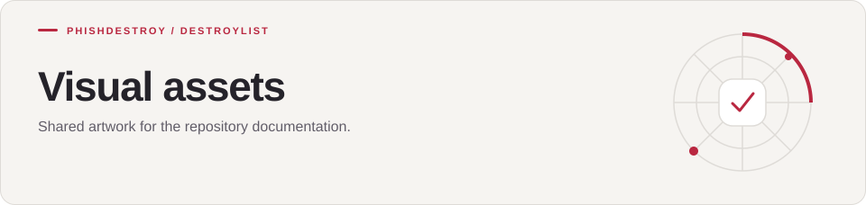

[Destroylist](../README.md) / assets

<h1>
<picture>
  <source media="(max-width: 640px)" srcset="banner-mobile.svg">
  
</picture>
</h1>

Shared artwork for the repository documentation.

---

| Assets | Usage |
| --- | --- |
| [Action buttons](actions/) | Compact links used by existing documentation |
| `hero.svg` / `hero-mobile.svg` | Main README artwork |
| `readme-divider.svg` | Section divider |
| `severity-*.svg` | API severity labels |

Directory banners use the same palette and include a mobile variant. SVGs adapt to the reader’s light or dark color preference; text remains available in each README.
