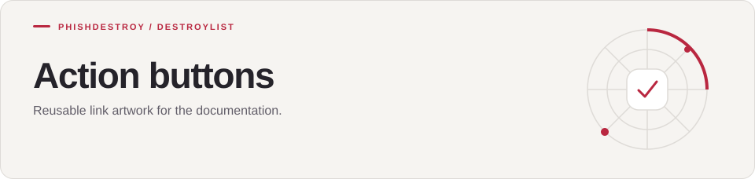

[Destroylist](../../README.md) / [assets](../README.md) / actions

<h1>
<picture>
  <source media="(max-width: 640px)" srcset="banner-mobile.svg">
  
</picture>
</h1>

Reusable link artwork for the documentation.

---

Each SVG contains its own label and accessible description. Use a normal link with descriptive text when an image button adds no useful context.

[Visual assets](../) · [Main README](../../README.md)
