<div align="center">



# Community Blocklist

**Auto-aggregated threat intelligence from 13+ public sources**


<p align="center">


</p>


<p align="center">
<a href="https://github.com/phishdestroy/destroylist"></a>
<a href="https://api.destroy.tools"></a>
</p>

</div>

---

> [!CAUTION]
> **Community Dataset — Research and Optional Filtering**
>
> Auto-aggregated collection of phishing/scam domains from **13+ public threat intelligence sources**. Available for **research**, pattern analysis, ML model training and optional filtering. Source coverage and false-positive rates vary; review the dataset before deploying it.

## Purpose

- Aggregate domains from multiple community feeds
- Analyze domain abuse and phishing patterns at scale
- Train AI/ML models and heuristic detection systems
- **Consumer-controlled filtering** — a listing takes effect when a user or service imports the feed into its own controls

## Files

| File | Description |
|:-----|:------------|
| `blocklist.json` | Merged & normalized domains |
| `blocklist.txt` | Plain text version |
| `live_blocklist.json` | DNS-verified (resolvable) |
| `live_blocklist.txt` | Plain text version |
| `content_live.json` | HTTP content-verified domains |
| `content_live.txt` | Plain text version |
| `dead_blocklist.json` | Non-resolving domains (research) |
| `state.json` | Per-source hash & counts |
| `count.json` | Total count badge |
| `live_count.json` | Live domain count badge |
| `content_active_count.json` | Content-verified count badge |

## Policy

Our community feeds are generated automatically. To correct a listing in our published copies, [submit an appeal](https://phishdestroy.io/appeals/); reviewed exclusions are applied through our allowlist. The original source maintains its own feed and must be contacted separately for a correction there.

Direct edits to generated feeds are overwritten; use the correction process. For a narrower starting point, choose the curated `list.json` feed.

## How It's Built

Generated by `smart_aggregator.py`:

1. Fetches from all source feeds
2. Normalizes and deduplicates
3. Outputs `blocklist.json` + metadata

DNS validation runs separately on the server via `dns/active_domains.py`:

```bash
python smart_aggregator.py
python dns/active_domains.py --force
```

## Sources

| Source | URL |
|:-------|:----|
| MetaMask | [eth-phishing-detect](https://github.com/MetaMask/eth-phishing-detect) |
| ScamSniffer | [scam-database](https://github.com/scamsniffer/scam-database) |
| SEAL (Security Alliance) | [blocklists](https://github.com/security-alliance/blocklists) |
| Polkadot JS | [phishing](https://github.com/polkadot-js/phishing) |
| OpenPhish | [public_feed](https://github.com/openphish/public_feed) |
| Crypto Firewall | [crypto-firewall](https://github.com/chartingshow/crypto-firewall) |
| Enkrypt | [phishing-detect](https://github.com/enkryptcom/phishing-detect) |
| SPMedia | [Crypto-Scam-Threat-Intel](https://github.com/spmedia/Crypto-Scam-and-Crypto-Phishing-Threat-Intel-Feed) |
| Codeesura | [Anti-phishing-extension](https://github.com/codeesura/Anti-phishing-extension) |
| Discord Phishing (Nikolai) | Discord phishing domain feed |
| Discord Phishing (Dogino) | Discord phishing domain feed |
| Phishunt | [phishunt.io](https://phishunt.io) |
| PhishDestroy | Primary curated list |

---

<div align="center">

[](https://github.com/phishdestroy/destroylist)

</div>
