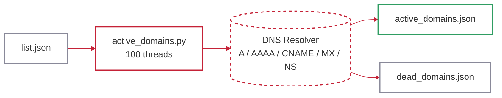

[Destroylist](../README.md) / dns

<h1>
<picture>
  <source media="(max-width: 640px)" srcset="banner-mobile.svg">
  
</picture>
</h1>

Resolution checks, content checks and activity metrics.

[Data files](#data-files) · [Activity metrics](#time-based-feeds) · [API](https://api.destroy.tools)

---

## How It Works

Multithreaded DNS resolver validates every domain in the blocklist against live DNS records (A, AAAA, CNAME, MX, NS). Only domains with active infrastructure are flagged as live threats.

## Data Files

| File | Description | Format |
|:-----|:------------|:------:|
| [`active_domains.json`](https://raw.githubusercontent.com/phishdestroy/destroylist/main/dns/active_domains.json) | All DNS-validated live domains | JSON |
| [`active_domains.txt`](https://raw.githubusercontent.com/phishdestroy/destroylist/main/dns/active_domains.txt) | Same as above, plain text | TXT |
| [`active_count.json`](https://raw.githubusercontent.com/phishdestroy/destroylist/main/dns/active_count.json) | Current active domain count | JSON |
| [`dead_domains.json`](https://raw.githubusercontent.com/phishdestroy/destroylist/main/dns/dead_domains.json) | Domains with no DNS records | JSON |
| [`content_active.json`](https://raw.githubusercontent.com/phishdestroy/destroylist/main/dns/content_active.json) | Active domains with HTTP content | JSON |
| [`content_active.txt`](https://raw.githubusercontent.com/phishdestroy/destroylist/main/dns/content_active.txt) | Same as above, plain text | TXT |

## Time-Based Feeds

| File | Description |
|:-----|:------------|
| [`today_added.json`](https://raw.githubusercontent.com/phishdestroy/destroylist/main/dns/today_added.json) | Count of domains added today |
| [`today_community.json`](https://raw.githubusercontent.com/phishdestroy/destroylist/main/dns/today_community.json) | Count of community domains added today |
| [`week_added.json`](https://raw.githubusercontent.com/phishdestroy/destroylist/main/dns/week_added.json) | Count of domains added this week |
| [`week_community.json`](https://raw.githubusercontent.com/phishdestroy/destroylist/main/dns/week_community.json) | Count of community domains added this week |
| [`month_added.json`](https://raw.githubusercontent.com/phishdestroy/destroylist/main/dns/month_added.json) | Count of domains added this month |
| [`month_community.json`](https://raw.githubusercontent.com/phishdestroy/destroylist/main/dns/month_community.json) | Count of community domains added this month |

## Script

[`active_domains.py`](active_domains.py) — Multithreaded DNS validator

- Resolves A, AAAA, CNAME, MX, NS records
- 100 concurrent threads for fast scanning
- Outputs JSON + TXT with deduplication
- Runs automatically via GitHub Actions

---

[Destroylist](../README.md) · [All feeds](../README.md#data-feeds) · [Appeals](https://phishdestroy.io/appeals/)
