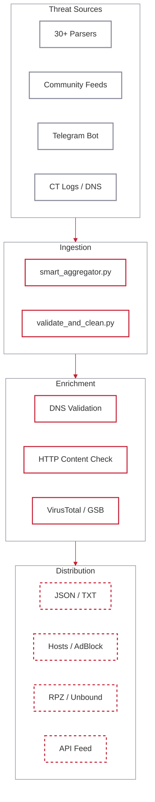
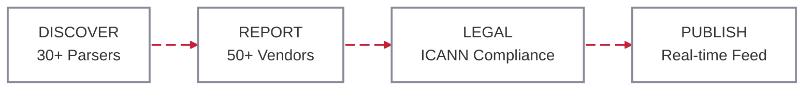

[Destroylist](../README.md) / [Guides](README.md) / About Destroylist

# About Destroylist

Discovery, reporting, investigations and public records.

Destroylist is a real-time threat intelligence platform by **PhishDestroy** — protecting firewalls, DNS resolvers, browser extensions, and security teams worldwide.

**Every domain is discovered, verified, reported to registrars, and published transparently.**

**Live feed counts above** · **13+** threat sources · **50+** vendor reports · **6** output formats · Free API

<sub>Live data collection began on July 1, 2025</sub>

### Data & integrations

<details>
<summary><b>Follow the data</b> · sources → checks → feeds</summary>



</details>

### Investigations & evidence

<a name="threat-intelligence--automated-remediation-workflow"></a>

<details>
<summary><b>How we hunt</b> · discovery, reports & remediation</summary>



<div>

| **DISCOVER** | **REPORT** | **LEGAL** | **PUBLISH** |
|:---:|:---:|:---:|:---:|
| 30+ parsers | 50+ vendors | ICANN compliance | Real-time |
| CT logs, DNS | Google, Microsoft | Abuse notifications | GitHub, Telegram |
| Social media | VirusTotal, Cloudflare | Evidence packages | Twitter, Mastodon |

</div>

### Phase 1: Pre-emptive Discovery & Ingestion

We utilize a distributed network of **30+ proprietary parsers** to identify malicious domains at their earliest stage:

- **Advanced Heuristics:** Continuous monitoring of Google Ads (Malvertising), SEO-manipulated search results, and trending social media campaigns on Twitter (X), YouTube, and Telegram
- **Infrastructure Analysis:** Leveraging *dnstwist* and typosquatting detection to catch look-alike domains targeting established brands
- **Community Intelligence:** Real-time ingestion of community-reported threats via our Telegram Bot and partner intelligence feeds

---

### Phase 2: Global Ecosystem Contribution

Once a threat is confirmed, we submit data to over **50 industry-leading vendors**:

```
Cloudflare        Google Safe Browsing      Microsoft Security      VirusTotal
Netcraft          ESET                      Bitdefender             Norton Safe Web
Avira             PhishTank                 Dr.Web                  Yandex Safe Browsing
URLScan.io        PolySwarm                 SiteReview              Urlquery
PhishStats        PhishReport               IsItPhish               ThreatCenter
```

---

### Phase 3: Legal Notifications & Investigation Support

- **Abuse Notifications:** Formal alerts to domain registrars and hosting providers
- **Forensic Evidence Disclosure:** Complete evidence packages including metadata, screenshots, and PDF reports
- **ICANN Compliance Support:** Reports aligned with ICANN standards
- **Conditional Re-Detection Logic:** Follow-up reports only while the threat remains active, never sooner than 48 hours after the previous report ([current reporting policy](https://phishdestroy.io/appeals/))

---

### Phase 4: Public Transparency & Community Alerts

- **Open Database:** Real-time commits to this GitHub repository
- **Live Monitoring:** Visual intelligence at [phishdestroy.io/live](https://phishdestroy.io/live/)
- **Social Broadcasting:** Automated alerts on Twitter, Telegram, and Mastodon

</details>

<a name="key-info-for-online-fraud-victims"></a>

<details>
<summary><b>For fraud victims</b> · reports, evidence & provider responsibility</summary>

DestroyList aims to disable malicious domains: scams, phishing, and other illicit sites to enhance internet safety.

### Before a domain is added, we:

1. **Scan it across cybersecurity platforms** for threat intelligence.
2. **Send an official complaint to the registrar and the hosting provider** (via WHOIS), including scan results, screenshots, and a request for client investigation. The complaint also notifies them about inclusion in our public database.

ICANN's [2013 RAA §3.18.1](https://www.icann.org/resources/pages/approved-with-specs-2013-09-17-en#3.18.1) requires registrars to take **reasonable and prompt steps to investigate and respond appropriately to abuse reports**. The **24-hour review requirement** in [§3.18.2](https://www.icann.org/resources/pages/approved-with-specs-2013-09-17-en#3.18.2) applies to well-founded reports of illegal activity from law enforcement, consumer-protection and other qualifying authorities, sent to the registrar's dedicated contact.

### When reports go ignored

We work hard to eliminate threats quickly. Every malicious domain is analyzed, documented, reported, and published transparently.

However, when a domain receives **10–30+ abuse reports** and a registrar still **ignores them for months**, the situation changes: the registrar is no longer a passive party.

It effectively provides infrastructure for illegal activity.

Some registrars behave as if their internal policies somehow override ICANN requirements and national laws — as if phishing and fraud are "allowed" as long as they personally decide not to act.

> **We document this publicly so that anyone can see:** threats persist not because they were unnoticed, but because the responsible providers simply chose to do nothing.

### Requests from private individuals:

DestroyList is an open-source, non-commercial volunteer project.

Private individuals may request the number of abuse reports we have sent for a specific domain, but only through public channels:
- via GitHub issues
- via commit history: https://github.com/phishdestroy/destroylist/commits/main/

**We do not respond to private e-mail requests** from individuals about report counts.

This is a legal requirement for transparency and equal access to information.

Official government or law-enforcement requests may be answered privately.

---

**If you were defrauded by a domain already listed here,** check its addition date using the commit history or via our Telegram/Mastodon channels.

If the fraud happened after the domain was already listed, the registrar's or host's delay may indicate they share responsibility for the loss. Future potential victims can also see this negligence documented publicly.

Registrars and hosts that tolerate scam operations may reasonably be expected to assist victims or their legal representatives.

</details>

<a name="use-cases--historical-vault"></a>

<details>
<summary><b>Research the record</b> · use cases & historical vault</summary>

Network security · Threat research · AI/ML training · Trend analysis · Automation

**Point-in-time history** — every state of the list is reconstructable:

| Granularity | Where | Retention |
|:---|:---|:---|
| Every change | [Commit history](https://github.com/phishdestroy/destroylist/commits/main/) | Forever (41,000+ commits) |
| Daily added/removed diffs | [`archives/changes/`](../archives/changes/) | Forever, searchable in GitHub code search |
| Weekly & monthly full snapshots | [`archives/`](../archives/) → [Release assets](https://github.com/phishdestroy/destroylist/releases/tag/archives) | Recent in tree, older rotated to the permanent Release |

> **Tip:**
> **Historical Vault** (500K+ domains, 5+ years archived): [contact@phishdestroy.io](mailto:contact@phishdestroy.io)

</details>


<a name="related-investigations--repositories"></a>

<details>
<summary><b>Related Investigations & Repositories</b></summary>

| Repository | Description |
|:-----------|:------------|
| [**namesilo-evidence**](https://github.com/phishdestroy/namesilo-evidence) | Evidence archive — NameSilo registrar abuse investigation |
| [**nicenic-evidence**](https://github.com/phishdestroy/nicenic-evidence) | Evidence archive — NiceNIC registrar abuse investigation |
| [**trustname-evidence**](https://github.com/phishdestroy/trustname-evidence) | Evidence archive — TrustName registrar abuse investigation |
| [**ScamIntelLogs**](https://github.com/phishdestroy/ScamIntelLogs) | Raw scam intelligence logs and IOC data |
| [**DestroyScammers**](https://github.com/phishdestroy/DestroyScammers) | Scammer exposure and disruption operations |

</details>
