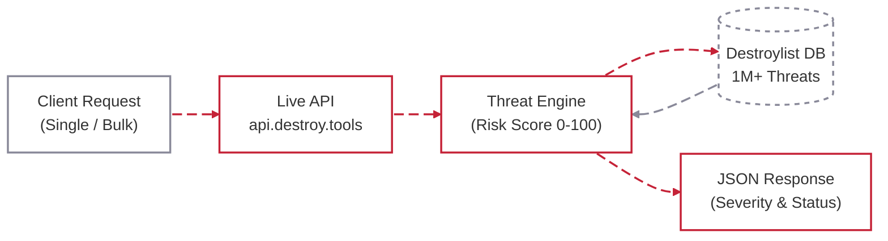

[Destroylist](../README.md) / [Guides](README.md) / Threat intelligence API

# Threat intelligence API

Endpoints, scoring and integration examples.

<p>
  <a href="https://api.destroy.tools"></a>
  <a href="https://api.destroy.tools/v1/stats"></a>
</p>

### Free, open, no API key.

Real-time **domain risk scoring (0-100)** across the Primary and Community datasets · scheduled sync

**Single & bulk check (500/req)** · Keyword search · Full feeds

<details>
<summary><b>Use the API</b> · endpoints, scoring & integration examples</summary>



### Endpoints

| Method | Endpoint | Description |
|:------:|:---------|:------------|
| `GET` | [`/v1/check?domain=`](https://api.destroy.tools/v1/check?domain=example-phish.xyz) | Single domain check with risk score & severity |
| `POST` | `/v1/check/bulk` | Bulk check up to **500 domains** per request |
| `GET` | [`/v1/search?q=`](https://api.destroy.tools/v1/search?q=metamask) | Search blocklisted domains by keyword |
| `GET` | [`/v1/feed/{list}`](https://api.destroy.tools/v1/feed/primary) | Download full domain feeds (primary, community, active) |
| `GET` | [`/v1/stats`](https://api.destroy.tools/v1/stats) | Live statistics & domain counts |

**Per-IP quotas:** 300 data units/minute; intelligence routes have 30 units/minute and 1,000/day. Request costs vary by endpoint. On HTTP 429, respect `Retry-After`. [Current limits and response schemas](https://api.destroy.tools/openapi.json).

### Threat Scoring

Listed-domain results include a **risk score (0–100)** and the API's severity verdict. Signals include curated and community listings, DNS/HTTP liveness, multiple sources and naming patterns. Unlisted domains can return separate heuristic signals; a missing listing is not a safety guarantee.

Use the returned `threat`, `severity` and `flags` fields. The [current OpenAPI specification](https://api.destroy.tools/openapi.json) defines each response shape.

<p>


</p>

### Quick Integration

**cURL**
```bash
curl "https://api.destroy.tools/v1/check?domain=suspicious-site.xyz"
```

**Python**
```python
import requests
domain = "example.com"
r = requests.get("https://api.destroy.tools/v1/check", params={"domain": domain}, timeout=30)
r.raise_for_status()
result = r.json()
if result["threat"]:
    print(f"BLOCKED: {result['severity']} (score: {result['risk_score']})")
```

**JavaScript**
```javascript
const domain = "example.com";
const r = await fetch(`https://api.destroy.tools/v1/check?domain=${encodeURIComponent(domain)}`);
if (!r.ok) throw new Error(`API returned HTTP ${r.status}`);
const data = await r.json();
if (data.threat) console.warn("PHISHING:", data.severity, data.risk_score);
```

**Bulk Check**
```bash
curl -X POST "https://api.destroy.tools/v1/check/bulk" \
  -H "Content-Type: application/json" \
  -d '{"domains":["site1.com","site2.xyz","site3.top"]}'
```

</details>
