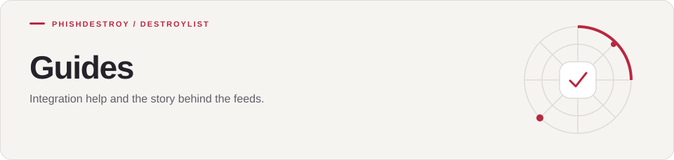

[Destroylist](../README.md) / docs

<h1>
<picture>
  <source media="(max-width: 640px)" srcset="banner-mobile.svg">
  
</picture>
</h1>

Integration help and the story behind the feeds.

---

| Guide | What you will find |
| --- | --- |
| [API](API.md) | Endpoints, scoring and code examples |
| [Integrations](INTEGRATIONS.md) | Subscription URLs and command-line examples |
| [About Destroylist](ABOUT.md) | Discovery, reporting and historical records |
