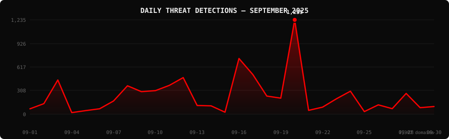

[Destroylist](../../../README.md) / [rootlist](../../README.md) / [2025](../README.md) / 09

<h1>
<picture>
  <source media="(max-width: 640px)" srcset="banner-mobile.svg">
  
</picture>
</h1>

Monthly threat report · activity, infrastructure and detection.

[Dashboard](#dashboard) · [Analysis](#intelligence-analysis) · [Downloads](#downloads--data) · [Year overview](../)

---

   

## Dashboard

<div align="center">

| detected | live | dead | enriched |
|:---:|:---:|:---:|:---:|
| **7,307** | **2,343** | **4,955** | **9** |

| VirusTotal | Google SB | Avg Response | Median |
|:---:|:---:|:---:|:---:|
| **6,342** (86.8%) | **297** | **3827.1h** | **3952.0h** |

</div>

<div align="center">

</div>

> `  ▂   ▁▂▁▁▂▃   ▄▃▁▁█  ▁▁   ▁  ` &nbsp; Peak: **2025-09-20** (1,235) &nbsp;·&nbsp; Low: **2025-09-04** (21) &nbsp;·&nbsp; Active days: **30**

<details>
<summary><b>Daily breakdown</b></summary>

| Date | Domains | Activity |
|:-----|--------:|:---------|
| `2025-09-01` | **70** | `█░░░░░░░░░░░░░░░░░░░` |
| `2025-09-02` | **138** | `██░░░░░░░░░░░░░░░░░░` |
| `2025-09-03` | **448** | `███████░░░░░░░░░░░░░` |
| `2025-09-04` | **21** | `░░░░░░░░░░░░░░░░░░░░` |
| `2025-09-05` | **47** | `█░░░░░░░░░░░░░░░░░░░` |
| `2025-09-06` | **71** | `█░░░░░░░░░░░░░░░░░░░` |
| `2025-09-07` | **173** | `███░░░░░░░░░░░░░░░░░` |
| `2025-09-08` | **372** | `██████░░░░░░░░░░░░░░` |
| `2025-09-09` | **295** | `█████░░░░░░░░░░░░░░░` |
| `2025-09-10` | **308** | `█████░░░░░░░░░░░░░░░` |
| `2025-09-11` | **377** | `██████░░░░░░░░░░░░░░` |
| `2025-09-12` | **479** | `████████░░░░░░░░░░░░` |
| `2025-09-13` | **114** | `██░░░░░░░░░░░░░░░░░░` |
| `2025-09-14` | **109** | `██░░░░░░░░░░░░░░░░░░` |
| `2025-09-15` | **26** | `░░░░░░░░░░░░░░░░░░░░` |
| `2025-09-16` | **729** | `████████████░░░░░░░░` |
| `2025-09-17` | **518** | `████████░░░░░░░░░░░░` |
| `2025-09-18` | **237** | `████░░░░░░░░░░░░░░░░` |
| `2025-09-19` | **210** | `███░░░░░░░░░░░░░░░░░` |
| `2025-09-20` | **1,235** | `████████████████████` |
| `2025-09-21` | **50** | `█░░░░░░░░░░░░░░░░░░░` |
| `2025-09-22` | **92** | `█░░░░░░░░░░░░░░░░░░░` |
| `2025-09-23` | **202** | `███░░░░░░░░░░░░░░░░░` |
| `2025-09-24` | **301** | `█████░░░░░░░░░░░░░░░` |
| `2025-09-25` | **34** | `█░░░░░░░░░░░░░░░░░░░` |
| `2025-09-26` | **122** | `██░░░░░░░░░░░░░░░░░░` |
| `2025-09-27` | **72** | `█░░░░░░░░░░░░░░░░░░░` |
| `2025-09-28` | **272** | `████░░░░░░░░░░░░░░░░` |
| `2025-09-29` | **85** | `█░░░░░░░░░░░░░░░░░░░` |
| `2025-09-30` | **100** | `██░░░░░░░░░░░░░░░░░░` |

</details>

---

## Intelligence Analysis

### Executive Summary
In September 2025, PhishDestroy observed a substantial surge in phishing domains, identifying a total of 7,307 cases, marking a 92.9% increase from the previous month. Of these, 2,343 domains remain active, while 4,955 have been neutralized, resulting in a kill rate of 67.8%. A significant finding this month is the dominance of the "Angel Drainer" tactic, featuring 1,120 instances. The average response time to address these threats was 3,827.1 hours, highlighting an area for improvement.

### Key Trends
- **Crypto/Drainer Landscape** — "Angel Drainer" was the most prevalent, recorded in 1,120 cases, a stark increase from the previous month's leading tactics.
- **Brand Targeting Shifts** — Generic Crypto brands were targeted 517 times, followed by SushiSwap at 398, indicating a focus on decentralized finance platforms.
- **Geographic Hotspots** — The USA remained the leading source with 3,049 domains, increasing from the last month's count, followed by Hong Kong at 747.
- **TLD Abuse Patterns** — ".com" TLDs were abused in 2,561 cases, maintaining their position as the most exploited, with ".xyz" showing a notable presence at 748.
- **Registrar Abuse Concentration** — NICENIC INTERNATIONAL GROUP CO., LIMITED saw 721 domains registered, positioning them as a critical focus for registrar accountability.
- **Detection/Response Metrics** — 6,342 domains were flagged by VirusTotal, indicating a strong detection rate, yet Google Safe Browsing only identified 297, suggesting a detection gap.

### Threat Actor Tactics
Threat actors continue to exploit infrastructure and hosting patterns with a mix of fast-flux techniques and bulletproof hosting, complicating takedown efforts. Nameserver clustering has been observed, indicating organized operations likely supported by robust CDN abuse.

The drainer landscape is evolving with the emergence of "Angel Drainer" and "Solana Drainer," both demonstrating increased sophistication in targeting wallet credentials. Techniques such as "Wallet Connect Abuse" are gaining traction, reflecting a shift towards more direct wallet compromise methods.

Evasion and obfuscation tactics have advanced, with threat actors effectively bypassing specific detection engines. The VT vendor detection spread shows that while some engines like alphaMountain.ai and Fortinet lead in coverage, there are notable gaps, particularly in lesser-known engines, allowing actors to evade detection.

### Registrar Accountability
The top five registrars implicated in phishing domain registrations this month are NICENIC INTERNATIONAL GROUP CO., LIMITED (721 domains), PDR Ltd. (527), NameSilo, LLC (481), and WEBCC (387), with N/A registrars topping at 726 domains. These registrars collectively account for a significant share of the phishing landscape, necessitating increased scrutiny and accountability.

Some registrars have shown improvement, with fewer domains registered under their management, while others, such as NICENIC INTERNATIONAL GROUP CO., LIMITED, have worsened. New entrants to the list indicate shifting patterns in threat actor preferences for domain registration.

### Detection Landscape
Analysis of VirusTotal vendor data reveals alphaMountain.ai and Fortinet as leaders in detection, with 3,011 and 2,933 flagged domains, respectively. Despite their strong performance, gaps remain, particularly in less prominent engines, underscoring the need for comprehensive detection strategies encompassing multiple vendors to mitigate these threats effectively.

### Recommendations
- **For Security Teams** — Implement multi-layered defense strategies that incorporate intelligence from leading detection engines to address gaps.
- **For SOC Analysts** — Prioritize the monitoring of domains registered with NICENIC INTERNATIONAL GROUP CO., LIMITED and similar high-risk registrars.
- **For Registrars** — Enhance vetting processes for domain registrations to prevent abuse, particularly for high-risk TLDs like ".com" and ".xyz".
- **For Browser Vendors** — Collaborate with intelligence providers to improve real-time detection and blocking of phishing domains.
- **For Crypto Projects** — Educate users on the risks of "Angel Drainer" tactics and reinforce secure wallet practices.
- **For End Users** — Remain vigilant against phishing attempts and verify the authenticity of crypto-related communications before engaging.

---

## Top Registrars

| # | Registrar | Domains | Share | Trend |
|:--:|:---|------:|:---|:---:|
| **1** | N/A | **726** | `█░░░░░░░░░░░░░░` 9.9% | 🔺 |
| **2** | NICENIC INTERNATIONAL GROUP CO., LIMITED | **721** | `█░░░░░░░░░░░░░░` 9.9% | 🔺 |
| **3** | PDR Ltd. d/b/a PublicDomainRegistry.com | **527** | `█░░░░░░░░░░░░░░` 7.2% | 🔺 |
| **4** | NameSilo, LLC | **481** | `█░░░░░░░░░░░░░░` 6.6% | 🔺 |
| **5** | WEBCC | **387** | `█░░░░░░░░░░░░░░` 5.3% | 🔺 |
| **6** | OwnRegistrar, Inc. | **327** | `█░░░░░░░░░░░░░░` 4.5% | 🔺 |
| **7** | Cloudflare, Inc. | **312** | `█░░░░░░░░░░░░░░` 4.3% | 🆕 |
| **8** | Web Commerce Communications Limited dba WebNic.cc | **261** | `█░░░░░░░░░░░░░░` 3.6% | 🔺 |
| **9** | NAMECHEAP INC | **205** | `░░░░░░░░░░░░░░░` 2.8% | 🔺 |
| **10** | DYNADOT LLC | **197** | `░░░░░░░░░░░░░░░` 2.7% | 🔺 |

> ⚠️ Top 3 registrars = **1,974** domains (27% of all threats)

---

## Domain Zones

| # | TLD | Domains | Share | vs Prev |
|:--:|:---|------:|------:|:---:|
| **1** | `.com` | **2,561** | 35.0% | 🔺 |
| **2** | `.xyz` | **748** | 10.2% | 🔺 |
| **3** | `.live` | **390** | 5.3% | 🔺 |
| **4** | `.app` | **335** | 4.6% | 🔺 |
| **5** | `.org` | **315** | 4.3% | 🔺 |
| **6** | `.net` | **190** | 2.6% | 🔺 |
| **7** | `.top` | **178** | 2.4% | 🔺 |
| **8** | `.io` | **133** | 1.8% | 🔺 |
| **9** | `.cc` | **121** | 1.7% | 🔺 |
| **10** | `.site` | **115** | 1.6% | 🔺 |

---

## Registrar Geography

| # | Country | Domains | Share |
|:--:|:---|------:|------:|
| **1** | USA | **3,049** | 41.7% |
| **2** | Unknown | **884** | 12.1% |
| **3** | Hong Kong | **747** | 10.2% |
| **4** | Malaysia | **675** | 9.2% |
| **5** | India | **552** | 7.6% |
| **6** | Lithuania | **218** | 3.0% |
| **7** | Singapore | **144** | 2.0% |
| **8** | China | **122** | 1.7% |
| **9** | Canada | **116** | 1.6% |
| **10** | Netherlands | **91** | 1.2% |

---

## Targeted Brands

| # | Brand | Domains | Share |
|:--:|:---|------:|------:|
| **1** | Generic Crypto | **517** | 7.1% |
| **2** | SushiSwap | **398** | 5.4% |
| **3** | Ledger | **180** | 2.5% |
| **4** | Crypto Scam | **126** | 1.7% |
| **5** | Linea | **100** | 1.4% |
| **6** | Solana | **91** | 1.2% |
| **7** | Generic Banking | **57** | 0.8% |
| **8** | Coinbase | **44** | 0.6% |
| **9** | Generic Cloudflare | **43** | 0.6% |
| **10** | Uniswap | **40** | 0.5% |

---

## Crypto Drainers & Kits

| # | Type | Domains |
|:--:|:---|------:|
| **1** | Angel Drainer | **1,120** |
| **2** | Solana Drainer | **332** |
| **3** | Wallet Connect Abuse | **305** |
| **4** | Ice Phishing | **12** |
| **5** | Inferno Drainer | **5** |

---

## Detection Engines (VirusTotal)

| # | Engine | Detections | Coverage |
|:--:|:---|------:|------:|
| **1** | alphaMountain.ai | **3,011** | 41.2% |
| **2** | Fortinet | **2,933** | 40.1% |
| **3** | Gridinsoft | **2,519** | 34.5% |
| **4** | CyRadar | **2,244** | 30.7% |
| **5** | G-Data | **2,127** | 29.1% |
| **6** | Forcepoint ThreatSeeker | **1,827** | 25.0% |
| **7** | Sophos | **1,597** | 21.9% |
| **8** | BitDefender | **1,505** | 20.6% |
| **9** | Seclookup | **1,313** | 18.0% |
| **10** | Lionic | **1,282** | 17.5% |
| **11** | Webroot | **1,200** | 16.4% |
| **12** | CRDF | **1,035** | 14.2% |
| **13** | ADMINUSLabs | **1,007** | 13.8% |
| **14** | SOCRadar | **896** | 12.3% |
| **15** | ESET | **867** | 11.9% |

>  &nbsp; 

---

## Downloads & Data

| Format | File | Description |
|:-------|:-----|:------------|
| 📋 Report | [`README.md`](.) | This report |
| 🗃️ Threats | [`2025-09-threats.json`](2025-09-threats.json) | **7,307** threats with VT vendors, scan URLs, IPs |
| 📈 Chart | [`2025-09-activity.svg`](2025-09-activity.svg) | Daily detection activity graph |

<details>
<summary><b>Threat JSON example</b></summary>

```json
{
  "domain": "onchainwebrecovery.com",
  "detected_at": "2025-09-01 12:29:26",
  "registrar": "Hosting Concepts B.V. d/b/a Registrar.eu",
  "registrar_country": "Netherlands",
  "tld": "com",
  "ip_address": "198.18.0.103",
  "nameservers": "ns1.rivaldns.com ns2.rivaldns.com",
  "status": "live",
  "target_brand": "",
  "drainer_type": "clean",
  "vt_detections": 5,
  "vt_vendors": [
    "alphaMountain.ai",
    "CyRadar",
    "Fortinet",
    "G-Data",
    "Gridinsoft"
  ],
  "gsb_flagged": false,
  "creation_date": "2025-08-22 09:06:12",
  "urlscan": "https://urlscan.io/result/01990540-8afb-713c-9ec1-e165990cd1e7/",
  "screenshot": "https://urlscan.io/screenshots/01990540-8afb-713c-9ec1-e165990cd1e7.png"
}
```

</details>

> 💡 **API access**: Query any domain at [`api.destroy.tools/v1/check`](https://api.destroy.tools/v1/check?domain=example.com) — free, no API key

---

## All Reports

| Report | Domains |
|:-------|--------:|
| [January 2025](../../2025/01/) | **1** |
| [February 2025](../../2025/02/) | **13** |
| [March 2025](../../2025/03/) | **2** |
| [April 2025](../../2025/04/) | **2** |
| [May 2025](../../2025/05/) | **2** |
| [June 2025](../../2025/06/) | **4** |
| [July 2025](../../2025/07/) | **700** |
| [August 2025](../../2025/08/) | **3,788** |
| 📍 **September 2025** | **7,307** |
| [October 2025](../../2025/10/) | **8,841** |
| [November 2025](../../2025/11/) | **12,581** |
| [December 2025](../../2025/12/) | **11,773** |
| [January 2026](../../2026/01/) | **8,932** |
| [February 2026](../../2026/02/) | **18,207** |
| [March 2026](../../2026/03/) | **4,042** |
| [April 2026](../../2026/04/) | **15,633** |
| [May 2026](../../2026/05/) | **7,021** |
| [June 2026](../../2026/06/) | **8,102** |

---

[**← Aug 2025**](../../2025/08/) &nbsp;·&nbsp; 📅 **September 2025** &nbsp;·&nbsp; [**Oct 2025 →**](../../2025/10/)

---

[Destroylist](../../../README.md) · [All feeds](../../../README.md#data-feeds) · [Appeals](https://phishdestroy.io/appeals/)
