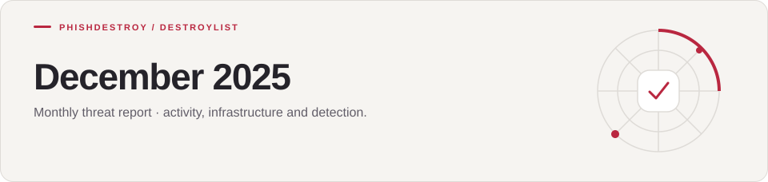
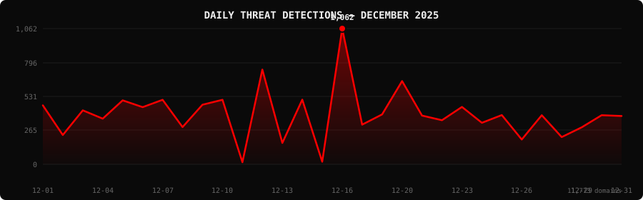

[Destroylist](../../../README.md) / [rootlist](../../README.md) / [2025](../README.md) / 12

<h1>
<picture>
  <source media="(max-width: 640px)" srcset="banner-mobile.svg">
  
</picture>
</h1>

Monthly threat report · activity, infrastructure and detection.

[Dashboard](#dashboard) · [Analysis](#intelligence-analysis) · [Downloads](#downloads--data) · [Year overview](../)

---

   

## Dashboard

<div align="center">

| detected | live | dead | enriched |
|:---:|:---:|:---:|:---:|
| **11,773** | **7,080** | **4,693** | **0** |

| VirusTotal | Google SB | Avg Response | Median |
|:---:|:---:|:---:|:---:|
| **11,557** (98.2%) | **1,963** | **1434.4h** | **1541.0h** |

</div>

<div align="center">

</div>

> `▃▁▃▂▃▃▃▂▃▃ ▅▁▃ █▂▂▄▂▂▃▂▂▁▂▁▂▂▂` &nbsp; Peak: **2025-12-16** (1,062) &nbsp;·&nbsp; Low: **2025-12-11** (16) &nbsp;·&nbsp; Active days: **30**

<details>
<summary><b>Daily breakdown</b></summary>

| Date | Domains | Activity |
|:-----|--------:|:---------|
| `2025-12-01` | **461** | `█████████░░░░░░░░░░░` |
| `2025-12-02` | **229** | `████░░░░░░░░░░░░░░░░` |
| `2025-12-03` | **422** | `████████░░░░░░░░░░░░` |
| `2025-12-04` | **357** | `███████░░░░░░░░░░░░░` |
| `2025-12-05` | **500** | `█████████░░░░░░░░░░░` |
| `2025-12-06` | **447** | `████████░░░░░░░░░░░░` |
| `2025-12-07` | **505** | `██████████░░░░░░░░░░` |
| `2025-12-08` | **291** | `█████░░░░░░░░░░░░░░░` |
| `2025-12-09` | **466** | `█████████░░░░░░░░░░░` |
| `2025-12-10` | **505** | `██████████░░░░░░░░░░` |
| `2025-12-11` | **16** | `░░░░░░░░░░░░░░░░░░░░` |
| `2025-12-12` | **741** | `██████████████░░░░░░` |
| `2025-12-13` | **167** | `███░░░░░░░░░░░░░░░░░` |
| `2025-12-14` | **506** | `██████████░░░░░░░░░░` |
| `2025-12-15` | **20** | `░░░░░░░░░░░░░░░░░░░░` |
| `2025-12-16` | **1,062** | `████████████████████` |
| `2025-12-17` | **310** | `██████░░░░░░░░░░░░░░` |
| `2025-12-18` | **390** | `███████░░░░░░░░░░░░░` |
| `2025-12-20` | **651** | `████████████░░░░░░░░` |
| `2025-12-21` | **381** | `███████░░░░░░░░░░░░░` |
| `2025-12-22` | **345** | `██████░░░░░░░░░░░░░░` |
| `2025-12-23` | **449** | `████████░░░░░░░░░░░░` |
| `2025-12-24` | **325** | `██████░░░░░░░░░░░░░░` |
| `2025-12-25` | **385** | `███████░░░░░░░░░░░░░` |
| `2025-12-26` | **194** | `████░░░░░░░░░░░░░░░░` |
| `2025-12-27` | **384** | `███████░░░░░░░░░░░░░` |
| `2025-12-28` | **213** | `████░░░░░░░░░░░░░░░░` |
| `2025-12-29` | **289** | `█████░░░░░░░░░░░░░░░` |
| `2025-12-30` | **384** | `███████░░░░░░░░░░░░░` |
| `2025-12-31` | **378** | `███████░░░░░░░░░░░░░` |

</details>

---

## Intelligence Analysis

### Executive Summary
In December 2025, PhishDestroy identified a total of 11,773 phishing domains, marking a 6.4% decrease from November's count of 12,581. Of these, 7,080 domains were active, while 4,693 were rendered inactive, resulting in a kill rate of 39.9%. VirusTotal flagged 11,557 domains, with Google Safe Browsing identifying 1,963. The average response time for takedowns was 1,434.4 hours. The most significant finding was the dominance of NICENIC INTERNATIONAL GROUP CO., LIMITED as the top registrar for malicious domains, responsible for 1,270 registrations.

### Key Trends
- **Crypto/Drainer Landscape** — Angel Drainer was the most prevalent, with 746 instances, followed by Wallet Connect Abuse at 418. This represents a shift from last month's focus on Solana Drainer.
- **Brand Targeting Shifts** — Crypto Scam was the most targeted brand with 822 cases, a slight shift from November when Coinbase was most targeted.
- **Geographic Hotspots** — The USA continued to lead with 5,443 domains, a 3% increase, while Hong Kong saw a notable rise to 1,526 from 1,200 in November.
- **TLD Abuse Patterns** — .com domains were the most abused TLD with 3,816 instances, consistent with the previous month. However, .app domains surged to 991 from last month's 850.
- **Registrar Abuse Concentration** — NICENIC INTERNATIONAL GROUP CO., LIMITED was the top registrar with 1,270 domains, a 10% increase from November.
- **Detection/Response Metrics** — VirusTotal flagged 98.2% of domains, with a slight improvement from November's 97.5%, indicating enhanced detection capabilities.

### Threat Actor Tactics
Threat actors continued to exploit infrastructure and hosting services with fast-flux techniques and bulletproof hosting providers. Nameserver clustering was observed predominantly with domains registered under NICENIC INTERNATIONAL GROUP CO., LIMITED, suggesting a coordinated effort to evade detection.

In the drainer and phishing kit landscape, Angel Drainer kits were the most sophisticated, integrating advanced wallet-targeting mechanisms. The evolution of Wallet Connect Abuse kits indicates a higher level of technical sophistication compared to previous months, focusing on bypassing multi-factor authentication.

Evasion and obfuscation tactics remained robust, with actors employing complex JavaScript obfuscation to avoid detection by specific engines. The spread of detections on VirusTotal showed notable gaps, particularly with newer engines, suggesting that actors are tailoring their evasion techniques to exploit these blind spots.

### Registrar Accountability
The top five registrars for malicious domains in December were NICENIC INTERNATIONAL GROUP CO., LIMITED (1,270 domains, 10.8%), Cloudflare, Inc. (1,100 domains, 9.3%), PDR Ltd. d/b/a PublicDomainRegistry.com (554 domains, 4.7%), CSC Corporate Domains, Inc. (547 domains, 4.6%), and Gname.com Pte. Ltd. (514 domains, 4.4%). These registrars account for a significant portion of the phishing landscape, necessitating increased scrutiny and accountability.

Compared to November, NICENIC INTERNATIONAL GROUP CO., LIMITED saw an increase in malicious registrations, while Cloudflare, Inc. maintained its volume. PDR Ltd. and CSC Corporate Domains showed slight improvements in reducing malicious registrations, whereas Gname.com Pte. Ltd. emerged as a new entrant in the top five list, indicating a shift in threat actor preferences.

### Detection Landscape
VirusTotal data highlighted SOCRadar as the leading detection engine, flagging 8,774 domains. CyRadar and Fortinet followed closely, maintaining consistent performance. However, detection gaps persist, particularly with newer engines like Lionic and alphaMountain.ai, which suggests a need for enhanced detection algorithms and collaboration among vendors to close these gaps and improve overall threat visibility.

### Recommendations
- **For Security Teams** — Implement proactive monitoring of registrar activity, focusing on those with high abuse rates to preemptively identify and mitigate threats.
- **For SOC Analysts** — Prioritize analysis of domains registered under top-abusing registrars, such as NICENIC INTERNATIONAL GROUP CO., LIMITED, to ensure timely response to threats.
- **For Registrars** — Enhance verification processes for domain registrations to prevent misuse and collaborate with cybersecurity firms for threat intelligence sharing.
- **For Browser Vendors** — Strengthen integration with threat intelligence feeds to improve in-browser phishing detection and user alerts.
- **For Crypto Projects** — Educate users on identifying and avoiding phishing attacks, particularly those targeting wallets and authentication methods.
- **For End Users** — Regularly update antivirus and security software to ensure comprehensive protection against the latest phishing techniques and exploits.

---

## Top Registrars

| # | Registrar | Domains | Share | Trend |
|:--:|:---|------:|:---|:---:|
| **1** | NICENIC INTERNATIONAL GROUP CO., LIMITED | **1,270** | `██░░░░░░░░░░░░░` 10.8% | 📈 |
| **2** | Cloudflare, Inc. | **1,100** | `█░░░░░░░░░░░░░░` 9.3% | 📉 |
| **3** | PDR Ltd. d/b/a PublicDomainRegistry.com | **554** | `█░░░░░░░░░░░░░░` 4.7% | 🔺 |
| **4** | CSC Corporate Domains, Inc. | **547** | `█░░░░░░░░░░░░░░` 4.6% | 🔺 |
| **5** | Gname.com Pte. Ltd. | **514** | `█░░░░░░░░░░░░░░` 4.4% | 📈 |
| **6** | GoDaddy.com, LLC | **470** | `█░░░░░░░░░░░░░░` 4.0% | 🔺 |
| **7** | TUCOWS DOMAINS, INC. | **418** | `█░░░░░░░░░░░░░░` 3.6% | 🔺 |
| **8** | REGRU-RU | **397** | `█░░░░░░░░░░░░░░` 3.4% | 🔺 |
| **9** | DYNADOT LLC | **335** | `░░░░░░░░░░░░░░░` 2.8% | 🔻 |
| **10** | NameSilo, LLC | **332** | `░░░░░░░░░░░░░░░` 2.8% | 📉 |

> ⚠️ Top 3 registrars = **2,924** domains (25% of all threats)

---

## Domain Zones

| # | TLD | Domains | Share | vs Prev |
|:--:|:---|------:|------:|:---:|
| **1** | `.com` | **3,816** | 32.4% | ➡️ |
| **2** | `.app` | **991** | 8.4% | 🔺 |
| **3** | `.dev` | **619** | 5.3% | 🔺 |
| **4** | `.io` | **609** | 5.2% | ➡️ |
| **5** | `.xyz` | **483** | 4.1% | 📉 |
| **6** | `.ru` | **453** | 3.8% | ➡️ |
| **7** | `.ai` | **349** | 3.0% | 🔺 |
| **8** | `.org` | **319** | 2.7% | 📈 |
| **9** | `.net` | **294** | 2.5% | ➡️ |
| **10** | `.cc` | **265** | 2.3% | 🔺 |

---

## Registrar Geography

| # | Country | Domains | Share |
|:--:|:---|------:|------:|
| **1** | USA | **5,443** | 46.2% |
| **2** | Hong Kong | **1,526** | 13.0% |
| **3** | India | **562** | 4.8% |
| **4** | Singapore | **557** | 4.7% |
| **5** | Russia | **468** | 4.0% |
| **6** | Canada | **455** | 3.9% |
| **7** | Malaysia | **398** | 3.4% |
| **8** | France | **378** | 3.2% |
| **9** | Unknown | **375** | 3.2% |
| **10** | Germany | **291** | 2.5% |

---

## Targeted Brands

| # | Brand | Domains | Share |
|:--:|:---|------:|------:|
| **1** | Crypto Scam | **822** | 7.0% |
| **2** | Coinbase | **716** | 6.1% |
| **3** | Kraken | **401** | 3.4% |
| **4** | Ledger | **335** | 2.8% |
| **5** | Generic Cloudflare | **215** | 1.8% |
| **6** | MetaMask | **200** | 1.7% |
| **7** | Generic Crypto | **167** | 1.4% |
| **8** | Trezor | **144** | 1.2% |
| **9** | Bet365 | **106** | 0.9% |
| **10** | Moonshot | **100** | 0.8% |

---

## Crypto Drainers & Kits

| # | Type | Domains |
|:--:|:---|------:|
| **1** | Angel Drainer | **746** |
| **2** | Wallet Connect Abuse | **418** |
| **3** | Solana Drainer | **252** |
| **4** | Inferno Drainer | **4** |
| **5** | Ice Phishing | **2** |
| **6** | MS Drainer | **1** |

---

## Detection Engines (VirusTotal)

| # | Engine | Detections | Coverage |
|:--:|:---|------:|------:|
| **1** | SOCRadar | **8,774** | 74.5% |
| **2** | CyRadar | **8,317** | 70.6% |
| **3** | Fortinet | **8,020** | 68.1% |
| **4** | alphaMountain.ai | **7,990** | 67.9% |
| **5** | Gridinsoft | **7,039** | 59.8% |
| **6** | Sophos | **6,444** | 54.7% |
| **7** | Lionic | **6,407** | 54.4% |
| **8** | BitDefender | **5,628** | 47.8% |
| **9** | G-Data | **5,579** | 47.4% |
| **10** | CRDF | **5,416** | 46.0% |
| **11** | ESET | **4,895** | 41.6% |
| **12** | ADMINUSLabs | **4,844** | 41.1% |
| **13** | Webroot | **4,839** | 41.1% |
| **14** | Forcepoint ThreatSeeker | **4,511** | 38.3% |
| **15** | VIPRE | **4,287** | 36.4% |

>  &nbsp; 

---

## Downloads & Data

| Format | File | Description |
|:-------|:-----|:------------|
| 📋 Report | [`README.md`](.) | This report |
| 🗃️ Threats | [`2025-12-threats.json`](2025-12-threats.json) | **11,773** threats with VT vendors, scan URLs, IPs |
| 📈 Chart | [`2025-12-activity.svg`](2025-12-activity.svg) | Daily detection activity graph |

<details>
<summary><b>Threat JSON example</b></summary>

```json
{
  "domain": "tredix.cc",
  "detected_at": "2025-12-01 21:36:32",
  "registrar": "NICENIC INTERNATIONAL GROUP CO., LIMITED",
  "registrar_country": "Hong Kong",
  "tld": "cc",
  "ip_address": "188.114.97.3",
  "nameservers": "austin.ns.cloudflare.com stevie.ns.cloudflare.com",
  "status": "live",
  "target_brand": "Crypto Scam",
  "drainer_type": "clean",
  "vt_detections": 15,
  "vt_vendors": [
    "ADMINUSLabs",
    "alphaMountain.ai",
    "BitDefender",
    "CyRadar",
    "ESET",
    "Forcepoint ThreatSeeker",
    "Fortinet",
    "G-Data",
    "Kaspersky",
    "Lionic",
    "Netcraft",
    "Seclookup",
    "SOCRadar",
    "Sophos",
    "VIPRE"
  ],
  "gsb_flagged": false,
  "creation_date": "2025-09-12 08:47:48",
  "urlscan": "https://urlscan.io/result/019a2cff-ca67-7645-a10a-a665aa81a98e/",
  "screenshot": "https://urlscan.io/screenshots/019a2cff-ca67-7645-a10a-a665aa81a98e.png"
}
```

</details>

> 💡 **API access**: Query any domain at [`api.destroy.tools/v1/check`](https://api.destroy.tools/v1/check?domain=example.com) — free, no API key

---

## All Reports

| Report | Domains |
|:-------|--------:|
| [January 2025](../../2025/01/) | **1** |
| [February 2025](../../2025/02/) | **13** |
| [March 2025](../../2025/03/) | **2** |
| [April 2025](../../2025/04/) | **2** |
| [May 2025](../../2025/05/) | **2** |
| [June 2025](../../2025/06/) | **4** |
| [July 2025](../../2025/07/) | **700** |
| [August 2025](../../2025/08/) | **3,788** |
| [September 2025](../../2025/09/) | **7,307** |
| [October 2025](../../2025/10/) | **8,841** |
| [November 2025](../../2025/11/) | **12,581** |
| 📍 **December 2025** | **11,773** |
| [January 2026](../../2026/01/) | **8,932** |
| [February 2026](../../2026/02/) | **18,207** |
| [March 2026](../../2026/03/) | **4,042** |
| [April 2026](../../2026/04/) | **15,633** |
| [May 2026](../../2026/05/) | **7,021** |
| [June 2026](../../2026/06/) | **8,102** |

---

[**← Nov 2025**](../../2025/11/) &nbsp;·&nbsp; 📅 **December 2025** &nbsp;·&nbsp; [**Jan 2026 →**](../../2026/01/)

---

[Destroylist](../../../README.md) · [All feeds](../../../README.md#data-feeds) · [Appeals](https://phishdestroy.io/appeals/)
