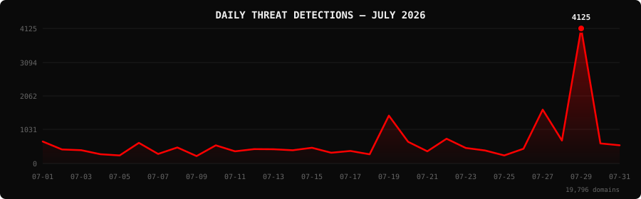

<!--
  PhishDestroy Threat Intelligence Report — July 2026
  19,796 phishing & scam domains detected · Kill rate: 80.4%
  Keywords: phishing report, threat intelligence, 2026-07, destroylist, scam domains, crypto drainer,
  phishing detection, domain blocklist, threat feed, VirusTotal, registrar abuse, brand impersonation,
  cryptocurrency phishing, wallet drainer, monthly security report, cybersecurity analytics
  Canonical: https://github.com/phishdestroy/destroylist/tree/main/rootlist/2026/07
  Previous: https://github.com/phishdestroy/destroylist/tree/main/rootlist/2026/06
  Data: https://github.com/phishdestroy/destroylist/tree/main/rootlist/2026/07/2026-07-threats.json
-->

[**← June 2026**](../../2026/06/) &nbsp;·&nbsp; 📅 **July 2026** &nbsp;·&nbsp; [**August 2026 →**](../../2026/08/)

 

  

  

##  Dashboard

|  |  |  |  |
|:---:|:---:|:---:|:---:|
| **19,796** | **3,866** | **15,824** | **19,735** |

|  |  |  |  |
|:---:|:---:|:---:|:---:|
| **18,831** (95.1%) | **1,144** | **837.0h** | **513h** |

> Peak: **2026-07-29** (4,125) &nbsp;·&nbsp; Low: **2026-07-09** (225) &nbsp;·&nbsp; Active days: **31**

📊 <b>Daily breakdown</b>

 

| Date | Domains | Activity |
|:-----|--------:|:---------|
| `2026-07-01` | **671** | `███░░░░░░░░░░░░░░░░░` |
| `2026-07-02` | **428** | `██░░░░░░░░░░░░░░░░░░` |
| `2026-07-03` | **406** | `██░░░░░░░░░░░░░░░░░░` |
| `2026-07-04` | **283** | `█░░░░░░░░░░░░░░░░░░░` |
| `2026-07-05` | **246** | `█░░░░░░░░░░░░░░░░░░░` |
| `2026-07-06` | **630** | `███░░░░░░░░░░░░░░░░░` |
| `2026-07-07` | **290** | `█░░░░░░░░░░░░░░░░░░░` |
| `2026-07-08` | **489** | `██░░░░░░░░░░░░░░░░░░` |
| `2026-07-09` | **225** | `█░░░░░░░░░░░░░░░░░░░` |
| `2026-07-10` | **554** | `███░░░░░░░░░░░░░░░░░` |
| `2026-07-11` | **372** | `██░░░░░░░░░░░░░░░░░░` |
| `2026-07-12` | **438** | `██░░░░░░░░░░░░░░░░░░` |
| `2026-07-13` | **435** | `██░░░░░░░░░░░░░░░░░░` |
| `2026-07-14` | **404** | `██░░░░░░░░░░░░░░░░░░` |
| `2026-07-15` | **480** | `██░░░░░░░░░░░░░░░░░░` |
| `2026-07-16` | **328** | `██░░░░░░░░░░░░░░░░░░` |
| `2026-07-17` | **383** | `██░░░░░░░░░░░░░░░░░░` |
| `2026-07-18` | **281** | `█░░░░░░░░░░░░░░░░░░░` |
| `2026-07-19` | **1,461** | `███████░░░░░░░░░░░░░` |
| `2026-07-20` | **662** | `███░░░░░░░░░░░░░░░░░` |
| `2026-07-21` | **371** | `██░░░░░░░░░░░░░░░░░░` |
| `2026-07-22` | **756** | `████░░░░░░░░░░░░░░░░` |
| `2026-07-23` | **474** | `██░░░░░░░░░░░░░░░░░░` |
| `2026-07-24` | **397** | `██░░░░░░░░░░░░░░░░░░` |
| `2026-07-25` | **246** | `█░░░░░░░░░░░░░░░░░░░` |
| `2026-07-26` | **449** | `██░░░░░░░░░░░░░░░░░░` |
| `2026-07-27` | **1,643** | `████████░░░░░░░░░░░░` |
| `2026-07-28` | **701** | `███░░░░░░░░░░░░░░░░░` |
| `2026-07-29` | **4,125** | `████████████████████` |
| `2026-07-30` | **612** | `███░░░░░░░░░░░░░░░░░` |
| `2026-07-31` | **556** | `███░░░░░░░░░░░░░░░░░` |

##  Intelligence Analysis

### Executive Summary

July 2026 detected **19,796** phishing and scam domains across 31 active days , a **+144%** change from June 2026's 8,101. The kill rate stands at **80.4%**, with 15,824 domains no longer serving content and 3,866 still live. VirusTotal flagged **95.1%** of the month's domains and Google Safe Browsing flagged 1,144. The leading registrar was NICENIC INTERNATIONAL GROUP CO., LIMITED with 2,530 domains (12.8%). Google was the most impersonated brand (874 domains).

### Key Trends

- **Volume** — 19,796 domains vs 8,101 in June 2026 (+144%).
- **VirusTotal coverage** — 95.1% vs 94.5% the previous month.
- **Registrars** — NICENIC INTERNATIONAL GROUP CO., LIMITED ranked #1 with 2,530 domains. New in the top 10: Wix Studio, GitHub, Inc., Spaceship, Inc..
- **Domain zones** — `.com` led with 7,809 domains (39.4%), followed by `.io`, `.app`, `.dev`.
- **Brands** — top targets were Google, Ledger, MetaMask. New in the top 10: MetaMask, Across, Facebook.

### Activity Patterns

Detections peaked on **2026-07-29** with 4,125 domains; the lowest day was 2026-07-09 (225). The daily average was 639 domains. Days below 10% of the peak: 13.

Crypto drainer kits identified this month: Solana Drainer (53), Wallet Connect Abuse (7), Angel Drainer (5).

### Registrar Accountability

NICENIC INTERNATIONAL GROUP CO., LIMITED (2,530, 12.8%), Wix Studio (1,359, 6.9%), Fewmoretaps OU d/b/a Trustname.com (893, 4.5%) were the three registrars with the most phishing domains this month.

Top 3 registrars account for **4,782 domains** (24.2% of threats).

### Detection Landscape

Gridinsoft (16,145, 81.6%), alphaMountain.ai (15,970, 80.7%), Forcepoint ThreatSeeker (13,742, 69.4%), Fortinet (13,724, 69.3%) were the most active VirusTotal engines. Overall, 18,831 of 19,796 domains (95.1%) had at least one VirusTotal detection.

### Recommendations

- **For Security Teams** — Subscribe to the destroylist feeds and block on VirusTotal consensus; 95.1% of this month's domains are already flagged.
- **For SOC Analysts** — Prioritise domains registered with NICENIC INTERNATIONAL GROUP CO., LIMITED in the `.com` zone, the highest-volume combination this month.
- **For Registrars** — NICENIC INTERNATIONAL GROUP CO., LIMITED and Wix Studio hold the largest share of reported domains; faster abuse handling would have the biggest impact.
- **For Brand Owners** — Google, Ledger, MetaMask should monitor for look-alike registrations.
- **For End Users** — Check unfamiliar crypto and login links at [api.destroy.tools](https://api.destroy.tools/v1/check?domain=example.com) before connecting a wallet.

##  Top Registrars

| # | Registrar | Domains | Share | Trend |
|:--:|:---|------:|:---|:---:|
| **1** | NICENIC INTERNATIONAL GROUP CO., LIMITED | **2,530** | `██░░░░░░░░░░░░░` 12.8% | 🔺 |
| **2** | Wix Studio | **1,359** | `█░░░░░░░░░░░░░░` 6.9% | 🆕 |
| **3** | Fewmoretaps OU d/b/a Trustname.com | **893** | `█░░░░░░░░░░░░░░` 4.5% | 🔺 |
| **4** | Cloudflare, Inc. | **787** | `█░░░░░░░░░░░░░░` 4.0% | 🔺 |
| **5** | Dynadot Inc | **695** | `█░░░░░░░░░░░░░░` 3.5% | 🔺 |
| **6** | GitHub, Inc. | **687** | `█░░░░░░░░░░░░░░` 3.5% | 🆕 |
| **7** | Spaceship, Inc. | **673** | `█░░░░░░░░░░░░░░` 3.4% | 🆕 |
| **8** | Gname.com Pte. Ltd. | **645** | `░░░░░░░░░░░░░░░` 3.3% | 🔺 |
| **9** | PDR Ltd. d/b/a PublicDomainRegistry.com | **605** | `░░░░░░░░░░░░░░░` 3.1% | 🔺 |
| **10** | NAMECHEAP INC | **585** | `░░░░░░░░░░░░░░░` 3.0% | 🆕 |

> ⚠️ Top 3 registrars = **4,782** domains (24.2% of all threats)

##  Domain Zones

| # | TLD | Domains | Share | vs Prev |
|:--:|:---|------:|------:|:---:|
| **1** | `.com` | **7,809** | 39.4% | 🔺 |
| **2** | `.io` | **1,480** | 7.5% | 🔺 |
| **3** | `.app` | **1,236** | 6.2% | 🔺 |
| **4** | `.dev` | **854** | 4.3% | 🔺 |
| **5** | `.xyz` | **695** | 3.5% | 🔺 |
| **6** | `.cc` | **614** | 3.1% | 🆕 |
| **7** | `.net` | **525** | 2.7% | 🔺 |
| **8** | `.live` | **477** | 2.4% | 🔺 |
| **9** | `.org` | **474** | 2.4% | 🔺 |
| **10** | `.top` | **415** | 2.1% | 🔺 |

##  Registrar Geography

| # | Country | Domains | Share |
|:--:|:---|------:|------:|
| **1** | Unknown | **11,678** | 59.0% |
| **2** | UNKNOWN | **4,293** | 21.7% |
| **3** | US | **1,520** | 7.7% |
| **4** | IS | **392** | 2.0% |
| **5** | CN | **201** | 1.0% |
| **6** | TR | **124** | 0.6% |
| **7** | SG | **115** | 0.6% |
| **8** | KN | **109** | 0.6% |
| **9** | GB | **100** | 0.5% |
| **10** | SC | **99** | 0.5% |

##  Targeted Brands

| # | Brand | Domains | Share |
|:--:|:---|------:|------:|
| **1** | Google | **874** | 4.4% |
| **2** | Ledger | **643** | 3.2% |
| **3** | MetaMask | **601** | 3.0% |
| **4** | Across | **379** | 1.9% |
| **5** | Facebook | **329** | 1.7% |
| **6** | Trezor | **324** | 1.6% |
| **7** | Bet365 | **293** | 1.5% |
| **8** | Cloudflare | **226** | 1.1% |
| **9** | Solana | **217** | 1.1% |
| **10** | Microsoft | **216** | 1.1% |

##  Crypto Drainers & Kits

| # | Type | Domains |
|:--:|:---|------:|
| **1** | Solana Drainer | **53** |
| **2** | Wallet Connect Abuse | **7** |
| **3** | Angel Drainer | **5** |

##  Detection Engines (VirusTotal)

| # | Engine | Detections | Coverage |
|:--:|:---|------:|------:|
| **1** | Gridinsoft | **16,145** | 81.6% |
| **2** | alphaMountain.ai | **15,970** | 80.7% |
| **3** | Forcepoint ThreatSeeker | **13,742** | 69.4% |
| **4** | Fortinet | **13,724** | 69.3% |
| **5** | SOCRadar | **13,408** | 67.7% |
| **6** | G-Data | **11,282** | 57.0% |
| **7** | CRDF | **10,993** | 55.5% |
| **8** | BitDefender | **10,952** | 55.3% |
| **9** | Sophos | **10,737** | 54.2% |
| **10** | Lionic | **9,813** | 49.6% |
| **11** | Chong Lua Dao | **8,042** | 40.6% |
| **12** | CyRadar | **7,904** | 39.9% |
| **13** | ESET | **7,671** | 38.8% |
| **14** | VIPRE | **7,198** | 36.4% |
| **15** | Webroot | **7,045** | 35.6% |

>  &nbsp; 

##  Downloads & Data

| Format | File | Description |
|:-------|:-----|:------------|
| 📋 Report | [`README.md`](.) | This report |
| 🗃️ Threats | [`2026-07-threats.json`](2026-07-threats.json) | **19,796** threats with registrars, IPs, VT vendors |
| 📈 Chart | [`2026-07-activity.svg`](2026-07-activity.svg) | Daily detection activity graph |

> 💡 **API access**: Query any domain at [`api.destroy.tools/v1/check`](https://api.destroy.tools/v1/check?domain=example.com) — free, no API key

##  All Reports

| Report | Domains |
|:-------|--------:|
| [January 2025](../../2025/01/) | **1** |
| [February 2025](../../2025/02/) | **13** |
| [March 2025](../../2025/03/) | **2** |
| [April 2025](../../2025/04/) | **2** |
| [May 2025](../../2025/05/) | **2** |
| [June 2025](../../2025/06/) | **4** |
| [July 2025](../../2025/07/) | **700** |
| [August 2025](../../2025/08/) | **3,788** |
| [September 2025](../../2025/09/) | **7,307** |
| [October 2025](../../2025/10/) | **8,841** |
| [November 2025](../../2025/11/) | **12,581** |
| [December 2025](../../2025/12/) | **11,773** |
| [January 2026](../../2026/01/) | **8,932** |
| [February 2026](../../2026/02/) | **18,207** |
| [March 2026](../../2026/03/) | **4,042** |
| [April 2026](../../2026/04/) | **15,633** |
| [May 2026](../../2026/05/) | **7,021** |
| [June 2026](../../2026/06/) | **8,101** |
| 📍 **July 2026** | **19,796** |
| [August 2026](../../2026/08/) | **19,782** |
| [September 2026](../../2026/09/) | **16,250** |
| [October 2026](../../2026/10/) | **6,995** |

[**← June 2026**](../../2026/06/) &nbsp;·&nbsp; 📅 **July 2026** &nbsp;·&nbsp; [**August 2026 →**](../../2026/08/)

 

 

Data: [destroylist](https://github.com/phishdestroy/destroylist)

