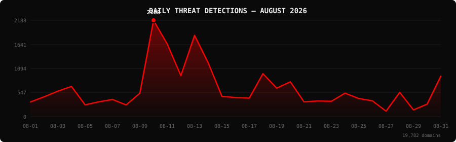

<!--
  PhishDestroy Threat Intelligence Report — August 2026
  19,782 phishing & scam domains detected · Kill rate: 70.3%
  Keywords: phishing report, threat intelligence, 2026-08, destroylist, scam domains, crypto drainer,
  phishing detection, domain blocklist, threat feed, VirusTotal, registrar abuse, brand impersonation,
  cryptocurrency phishing, wallet drainer, monthly security report, cybersecurity analytics
  Canonical: https://github.com/phishdestroy/destroylist/tree/main/rootlist/2026/08
  Previous: https://github.com/phishdestroy/destroylist/tree/main/rootlist/2026/07
  Data: https://github.com/phishdestroy/destroylist/tree/main/rootlist/2026/08/2026-08-threats.json
-->

[**← July 2026**](../../2026/07/) &nbsp;·&nbsp; 📅 **August 2026** &nbsp;·&nbsp; [**September 2026 →**](../../2026/09/)

 

  

  

##  Dashboard

|  |  |  |  |
|:---:|:---:|:---:|:---:|
| **19,782** | **5,819** | **13,749** | **5,602** |

|  |  |  |  |
|:---:|:---:|:---:|:---:|
| **19,603** (99.1%) | **1,202** | **502.7h** | **494h** |

> Peak: **2026-08-10** (2,188) &nbsp;·&nbsp; Low: **2026-08-27** (124) &nbsp;·&nbsp; Active days: **31**

📊 <b>Daily breakdown</b>

 

| Date | Domains | Activity |
|:-----|--------:|:---------|
| `2026-08-01` | **333** | `███░░░░░░░░░░░░░░░░░` |
| `2026-08-02` | **450** | `████░░░░░░░░░░░░░░░░` |
| `2026-08-03` | **578** | `█████░░░░░░░░░░░░░░░` |
| `2026-08-04` | **686** | `██████░░░░░░░░░░░░░░` |
| `2026-08-05` | **268** | `██░░░░░░░░░░░░░░░░░░` |
| `2026-08-06` | **336** | `███░░░░░░░░░░░░░░░░░` |
| `2026-08-07` | **390** | `████░░░░░░░░░░░░░░░░` |
| `2026-08-08` | **266** | `██░░░░░░░░░░░░░░░░░░` |
| `2026-08-09` | **532** | `█████░░░░░░░░░░░░░░░` |
| `2026-08-10` | **2,188** | `████████████████████` |
| `2026-08-11` | **1,652** | `███████████████░░░░░` |
| `2026-08-12` | **932** | `█████████░░░░░░░░░░░` |
| `2026-08-13` | **1,846** | `█████████████████░░░` |
| `2026-08-14` | **1,220** | `███████████░░░░░░░░░` |
| `2026-08-15` | **461** | `████░░░░░░░░░░░░░░░░` |
| `2026-08-16` | **433** | `████░░░░░░░░░░░░░░░░` |
| `2026-08-17` | **420** | `████░░░░░░░░░░░░░░░░` |
| `2026-08-18` | **976** | `█████████░░░░░░░░░░░` |
| `2026-08-19` | **647** | `██████░░░░░░░░░░░░░░` |
| `2026-08-20` | **791** | `███████░░░░░░░░░░░░░` |
| `2026-08-21` | **336** | `███░░░░░░░░░░░░░░░░░` |
| `2026-08-22` | **356** | `███░░░░░░░░░░░░░░░░░` |
| `2026-08-23` | **349** | `███░░░░░░░░░░░░░░░░░` |
| `2026-08-24` | **533** | `█████░░░░░░░░░░░░░░░` |
| `2026-08-25` | **412** | `████░░░░░░░░░░░░░░░░` |
| `2026-08-26` | **359** | `███░░░░░░░░░░░░░░░░░` |
| `2026-08-27` | **124** | `█░░░░░░░░░░░░░░░░░░░` |
| `2026-08-28` | **552** | `█████░░░░░░░░░░░░░░░` |
| `2026-08-29` | **153** | `█░░░░░░░░░░░░░░░░░░░` |
| `2026-08-30` | **284** | `███░░░░░░░░░░░░░░░░░` |
| `2026-08-31` | **919** | `████████░░░░░░░░░░░░` |

##  Intelligence Analysis

### Executive Summary

August 2026 detected **19,782** phishing and scam domains across 31 active days , a **+0%** change from July 2026's 19,796. The kill rate stands at **70.3%**, with 13,749 domains no longer serving content and 5,819 still live. VirusTotal flagged **99.1%** of the month's domains and Google Safe Browsing flagged 1,202. The leading registrar was NICENIC INTERNATIONAL GROUP CO., LIMITED with 1,681 domains (8.5%). MetaMask was the most impersonated brand (1,959 domains).

### Key Trends

- **Volume** — 19,782 domains vs 19,796 in July 2026 (+0%).
- **VirusTotal coverage** — 99.1% vs 95.1% the previous month.
- **Registrars** — NICENIC INTERNATIONAL GROUP CO., LIMITED ranked #1 with 1,681 domains. New in the top 10: GoDaddy.com, LLC, Vercel, Cloudflare Pages.
- **Domain zones** — `.com` led with 7,070 domains (35.7%), followed by `.app`, `.dev`, `.io`.
- **Brands** — top targets were MetaMask, Google, Across. New in the top 10: Adobe, Apple, Amazon.

### Activity Patterns

Detections peaked on **2026-08-10** with 2,188 domains; the lowest day was 2026-08-27 (124). The daily average was 638 domains. Days below 10% of the peak: 2.

Crypto drainer kits identified this month: Solana Drainer (76), Angel Drainer (7), Wallet Connect Abuse (1).

### Registrar Accountability

NICENIC INTERNATIONAL GROUP CO., LIMITED (1,681, 8.5%), Dynadot Inc (1,015, 5.1%), GoDaddy.com, LLC (963, 4.9%) were the three registrars with the most phishing domains this month.

Top 3 registrars account for **3,659 domains** (18.5% of threats).

### Detection Landscape

Forcepoint ThreatSeeker (18,458, 93.3%), alphaMountain.ai (17,540, 88.7%), Gridinsoft (16,114, 81.5%), SOCRadar (14,684, 74.2%) were the most active VirusTotal engines. Overall, 19,603 of 19,782 domains (99.1%) had at least one VirusTotal detection.

### Recommendations

- **For Security Teams** — Subscribe to the destroylist feeds and block on VirusTotal consensus; 99.1% of this month's domains are already flagged.
- **For SOC Analysts** — Prioritise domains registered with NICENIC INTERNATIONAL GROUP CO., LIMITED in the `.com` zone, the highest-volume combination this month.
- **For Registrars** — NICENIC INTERNATIONAL GROUP CO., LIMITED and Dynadot Inc hold the largest share of reported domains; faster abuse handling would have the biggest impact.
- **For Brand Owners** — MetaMask, Google, Across should monitor for look-alike registrations.
- **For End Users** — Check unfamiliar crypto and login links at [api.destroy.tools](https://api.destroy.tools/v1/check?domain=example.com) before connecting a wallet.

##  Top Registrars

| # | Registrar | Domains | Share | Trend |
|:--:|:---|------:|:---|:---:|
| **1** | NICENIC INTERNATIONAL GROUP CO., LIMITED | **1,681** | `█░░░░░░░░░░░░░░` 8.5% | 🔻 |
| **2** | Dynadot Inc | **1,015** | `█░░░░░░░░░░░░░░` 5.1% | 🔺 |
| **3** | GoDaddy.com, LLC | **963** | `█░░░░░░░░░░░░░░` 4.9% | 🆕 |
| **4** | Vercel | **949** | `█░░░░░░░░░░░░░░` 4.8% | 🆕 |
| **5** | Cloudflare Pages | **934** | `█░░░░░░░░░░░░░░` 4.7% | 🆕 |
| **6** | Fewmoretaps OU d/b/a Trustname.com | **835** | `█░░░░░░░░░░░░░░` 4.2% | 🔻 |
| **7** | Netlify | **745** | `█░░░░░░░░░░░░░░` 3.8% | 🆕 |
| **8** | Global Domain Group LLC | **672** | `█░░░░░░░░░░░░░░` 3.4% | 🆕 |
| **9** | Squarespace Domains II LLC. | **623** | `░░░░░░░░░░░░░░░` 3.1% | 🆕 |
| **10** | NameCheap, Inc. | **598** | `░░░░░░░░░░░░░░░` 3.0% | 🆕 |

> ⚠️ Top 3 registrars = **3,659** domains (18.5% of all threats)

##  Domain Zones

| # | TLD | Domains | Share | vs Prev |
|:--:|:---|------:|------:|:---:|
| **1** | `.com` | **7,070** | 35.7% | 🔻 |
| **2** | `.app` | **2,689** | 13.6% | 🔺 |
| **3** | `.dev` | **1,078** | 5.4% | 🔺 |
| **4** | `.io` | **828** | 4.2% | 🔻 |
| **5** | `.net` | **616** | 3.1% | 🔺 |
| **6** | `.xyz` | **572** | 2.9% | 🔻 |
| **7** | `.org` | **506** | 2.6% | 🔺 |
| **8** | `.cc` | **341** | 1.7% | 🔻 |
| **9** | `.live` | **334** | 1.7% | 🔻 |
| **10** | `.shop` | **317** | 1.6% | 🆕 |

##  Registrar Geography

| # | Country | Domains | Share |
|:--:|:---|------:|------:|
| **1** | Unknown | **13,127** | 66.4% |
| **2** | UNKNOWN | **3,514** | 17.8% |
| **3** | US | **1,279** | 6.5% |
| **4** | IS | **293** | 1.5% |
| **5** | CN | **125** | 0.6% |
| **6** | KN | **122** | 0.6% |
| **7** | DE | **92** | 0.5% |
| **8** | GB | **86** | 0.4% |
| **9** | SG | **75** | 0.4% |
| **10** | CY | **74** | 0.4% |

##  Targeted Brands

| # | Brand | Domains | Share |
|:--:|:---|------:|------:|
| **1** | MetaMask | **1,959** | 9.9% |
| **2** | Google | **1,752** | 8.9% |
| **3** | Across | **953** | 4.8% |
| **4** | Cloudflare | **532** | 2.7% |
| **5** | Trezor | **318** | 1.6% |
| **6** | Ledger | **297** | 1.5% |
| **7** | Adobe | **264** | 1.3% |
| **8** | Facebook | **236** | 1.2% |
| **9** | Apple | **233** | 1.2% |
| **10** | Amazon | **216** | 1.1% |

##  Crypto Drainers & Kits

| # | Type | Domains |
|:--:|:---|------:|
| **1** | Solana Drainer | **76** |
| **2** | Angel Drainer | **7** |
| **3** | Wallet Connect Abuse | **1** |

##  Detection Engines (VirusTotal)

| # | Engine | Detections | Coverage |
|:--:|:---|------:|------:|
| **1** | Forcepoint ThreatSeeker | **18,458** | 93.3% |
| **2** | alphaMountain.ai | **17,540** | 88.7% |
| **3** | Gridinsoft | **16,114** | 81.5% |
| **4** | SOCRadar | **14,684** | 74.2% |
| **5** | Fortinet | **12,333** | 62.3% |
| **6** | G-Data | **9,721** | 49.1% |
| **7** | BitDefender | **9,409** | 47.6% |
| **8** | Sophos | **8,793** | 44.4% |
| **9** | Lionic | **7,889** | 39.9% |
| **10** | CRDF | **7,833** | 39.6% |
| **11** | VIPRE | **6,827** | 34.5% |
| **12** | Kaspersky | **6,786** | 34.3% |
| **13** | ESET | **6,545** | 33.1% |
| **14** | Chong Lua Dao | **5,677** | 28.7% |
| **15** | Webroot | **5,658** | 28.6% |

>  &nbsp; 

##  Downloads & Data

| Format | File | Description |
|:-------|:-----|:------------|
| 📋 Report | [`README.md`](.) | This report |
| 🗃️ Threats | [`2026-08-threats.json`](2026-08-threats.json) | **19,782** threats with registrars, IPs, VT vendors |
| 📈 Chart | [`2026-08-activity.svg`](2026-08-activity.svg) | Daily detection activity graph |

> 💡 **API access**: Query any domain at [`api.destroy.tools/v1/check`](https://api.destroy.tools/v1/check?domain=example.com) — free, no API key

##  All Reports

| Report | Domains |
|:-------|--------:|
| [January 2025](../../2025/01/) | **1** |
| [February 2025](../../2025/02/) | **13** |
| [March 2025](../../2025/03/) | **2** |
| [April 2025](../../2025/04/) | **2** |
| [May 2025](../../2025/05/) | **2** |
| [June 2025](../../2025/06/) | **4** |
| [July 2025](../../2025/07/) | **700** |
| [August 2025](../../2025/08/) | **3,788** |
| [September 2025](../../2025/09/) | **7,307** |
| [October 2025](../../2025/10/) | **8,841** |
| [November 2025](../../2025/11/) | **12,581** |
| [December 2025](../../2025/12/) | **11,773** |
| [January 2026](../../2026/01/) | **8,932** |
| [February 2026](../../2026/02/) | **18,207** |
| [March 2026](../../2026/03/) | **4,042** |
| [April 2026](../../2026/04/) | **15,633** |
| [May 2026](../../2026/05/) | **7,021** |
| [June 2026](../../2026/06/) | **8,101** |
| [July 2026](../../2026/07/) | **19,796** |
| 📍 **August 2026** | **19,782** |
| [September 2026](../../2026/09/) | **16,250** |
| [October 2026](../../2026/10/) | **6,995** |

[**← July 2026**](../../2026/07/) &nbsp;·&nbsp; 📅 **August 2026** &nbsp;·&nbsp; [**September 2026 →**](../../2026/09/)

 

 

Data: [destroylist](https://github.com/phishdestroy/destroylist)

