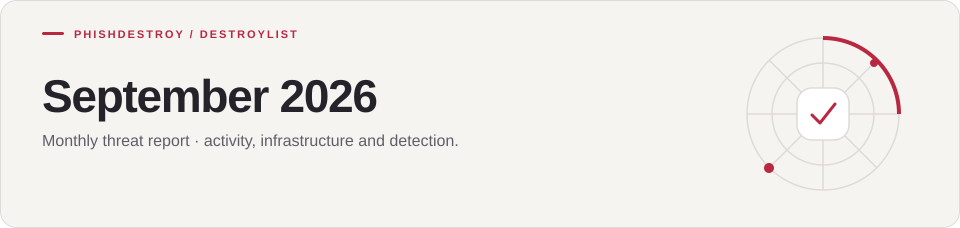
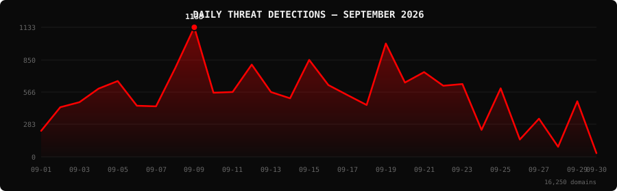

[Destroylist](../../../README.md) / [rootlist](../../README.md) / [2026](../README.md) / 09

<h1>
<picture>
  <source media="(max-width: 640px)" srcset="banner-mobile.svg">
  
</picture>
</h1>

Monthly threat report · activity, infrastructure and detection.

[Dashboard](#dashboard) · [Analysis](#intelligence-analysis) · [Downloads](#downloads--data) · [Year overview](../)

---

   

## Dashboard

| detected | live | dead | enriched |
|:---:|:---:|:---:|:---:|
| **16,250** | **7,110** | **8,974** | **6,451** |

| VirusTotal | Google SB | Avg Response | Median |
|:---:|:---:|:---:|:---:|
| **16,106** (99.1%) | **906** | **212.8h** | **149h** |

> Peak: **2026-09-09** (1,133) &nbsp;·&nbsp; Low: **2026-09-30** (33) &nbsp;·&nbsp; Active days: **30**

<b>Daily breakdown</b>

| Date | Domains | Activity |
|:-----|--------:|:---------|
| `2026-09-01` | **228** | `████░░░░░░░░░░░░░░░░` |
| `2026-09-02` | **434** | `████████░░░░░░░░░░░░` |
| `2026-09-03` | **478** | `████████░░░░░░░░░░░░` |
| `2026-09-04` | **597** | `███████████░░░░░░░░░` |
| `2026-09-05` | **663** | `████████████░░░░░░░░` |
| `2026-09-06` | **447** | `████████░░░░░░░░░░░░` |
| `2026-09-07` | **442** | `████████░░░░░░░░░░░░` |
| `2026-09-08` | **775** | `██████████████░░░░░░` |
| `2026-09-09` | **1,133** | `████████████████████` |
| `2026-09-10` | **561** | `██████████░░░░░░░░░░` |
| `2026-09-11` | **567** | `██████████░░░░░░░░░░` |
| `2026-09-12` | **807** | `██████████████░░░░░░` |
| `2026-09-13` | **567** | `██████████░░░░░░░░░░` |
| `2026-09-14` | **512** | `█████████░░░░░░░░░░░` |
| `2026-09-15` | **848** | `███████████████░░░░░` |
| `2026-09-16` | **628** | `███████████░░░░░░░░░` |
| `2026-09-17` | **540** | `██████████░░░░░░░░░░` |
| `2026-09-18` | **454** | `████████░░░░░░░░░░░░` |
| `2026-09-19` | **991** | `█████████████████░░░` |
| `2026-09-20` | **650** | `███████████░░░░░░░░░` |
| `2026-09-21` | **741** | `█████████████░░░░░░░` |
| `2026-09-22` | **622** | `███████████░░░░░░░░░` |
| `2026-09-23` | **637** | `███████████░░░░░░░░░` |
| `2026-09-24` | **236** | `████░░░░░░░░░░░░░░░░` |
| `2026-09-25` | **599** | `███████████░░░░░░░░░` |
| `2026-09-26` | **152** | `███░░░░░░░░░░░░░░░░░` |
| `2026-09-27` | **334** | `██████░░░░░░░░░░░░░░` |
| `2026-09-28` | **88** | `██░░░░░░░░░░░░░░░░░░` |
| `2026-09-29` | **486** | `█████████░░░░░░░░░░░` |
| `2026-09-30` | **33** | `█░░░░░░░░░░░░░░░░░░░` |

---

## Intelligence Analysis

### Executive Summary

September 2026 detected **16,250** phishing and scam domains across 30 active days , a **-18%** change from August 2026's 19,782. The kill rate stands at **55.8%**, with 8,974 domains no longer serving content and 7,110 still live. VirusTotal flagged **99.1%** of the month's domains and Google Safe Browsing flagged 906. The leading registrar was Dynadot Inc with 2,231 domains (13.7%). MetaMask was the most impersonated brand (1,172 domains).

### Key Trends

- **Volume** — 16,250 domains vs 19,782 in August 2026 (-18%).
- **VirusTotal coverage** — 99.1% vs 99.1% the previous month.
- **Registrars** — Dynadot Inc ranked #1 with 2,231 domains. New in the top 10: Spaceship, Inc., NAMECHEAP INC, NameSilo, LLC.
- **Domain zones** — `.com` led with 5,525 domains (34.0%), followed by `.shop`, `.app`, `.dev`.
- **Brands** — top targets were MetaMask, Google, Across. New in the top 10: Investment Scam, Kraken, Coinbase.

### Activity Patterns

Detections peaked on **2026-09-09** with 1,133 domains; the lowest day was 2026-09-30 (33). The daily average was 542 domains. Days below 10% of the peak: 2.

Crypto drainer kits identified this month: Solana Drainer (50), Angel Drainer (10), Wallet Connect Abuse (5).

### Registrar Accountability

Dynadot Inc (2,231, 13.7%), NICENIC INTERNATIONAL GROUP CO., LIMITED (1,113, 6.8%), Cloudflare Pages (756, 4.7%) were the three registrars with the most phishing domains this month.

Top 3 registrars account for **4,100 domains** (25.2% of threats).

### Detection Landscape

Forcepoint ThreatSeeker (14,233, 87.6%), alphaMountain.ai (13,990, 86.1%), Gridinsoft (12,789, 78.7%), SOCRadar (12,681, 78.0%) were the most active VirusTotal engines. Overall, 16,106 of 16,250 domains (99.1%) had at least one VirusTotal detection.

### Recommendations

- **For Security Teams** — Subscribe to the destroylist feeds and block on VirusTotal consensus; 99.1% of this month's domains are already flagged.
- **For SOC Analysts** — Prioritise domains registered with Dynadot Inc in the `.com` zone, the highest-volume combination this month.
- **For Registrars** — Dynadot Inc and NICENIC INTERNATIONAL GROUP CO., LIMITED hold the largest share of reported domains; faster abuse handling would have the biggest impact.
- **For Brand Owners** — MetaMask, Google, Across should monitor for look-alike registrations.
- **For End Users** — Check unfamiliar crypto and login links at [api.destroy.tools](https://api.destroy.tools/v1/check?domain=example.com) before connecting a wallet.

---

## Top Registrars

| # | Registrar | Domains | Share | Trend |
|:--:|:---|------:|:---|:---:|
| **1** | Dynadot Inc | **2,231** | `██░░░░░░░░░░░░░` 13.7% | 🔺 |
| **2** | NICENIC INTERNATIONAL GROUP CO., LIMITED | **1,113** | `█░░░░░░░░░░░░░░` 6.8% | 🔻 |
| **3** | Cloudflare Pages | **756** | `█░░░░░░░░░░░░░░` 4.7% | 🔻 |
| **4** | Global Domain Group LLC | **558** | `█░░░░░░░░░░░░░░` 3.4% | 🔻 |
| **5** | Spaceship, Inc. | **547** | `█░░░░░░░░░░░░░░` 3.4% | 🆕 |
| **6** | NAMECHEAP INC | **513** | `░░░░░░░░░░░░░░░` 3.2% | 🆕 |
| **7** | GoDaddy.com, LLC | **463** | `░░░░░░░░░░░░░░░` 2.8% | 🔻 |
| **8** | Vercel | **456** | `░░░░░░░░░░░░░░░` 2.8% | 🔻 |
| **9** | NameCheap, Inc. | **441** | `░░░░░░░░░░░░░░░` 2.7% | 🔻 |
| **10** | NameSilo, LLC | **430** | `░░░░░░░░░░░░░░░` 2.6% | 🆕 |

> ⚠️ Top 3 registrars = **4,100** domains (25.2% of all threats)

---

## Domain Zones

| # | TLD | Domains | Share | vs Prev |
|:--:|:---|------:|------:|:---:|
| **1** | `.com` | **5,525** | 34.0% | 🔻 |
| **2** | `.shop` | **1,747** | 10.8% | 🔺 |
| **3** | `.app` | **1,064** | 6.5% | 🔻 |
| **4** | `.dev` | **977** | 6.0% | 🔻 |
| **5** | `.io` | **631** | 3.9% | 🔻 |
| **6** | `.net` | **430** | 2.6% | 🔻 |
| **7** | `.xyz` | **409** | 2.5% | 🔻 |
| **8** | `.org` | **341** | 2.1% | 🔻 |
| **9** | `.live` | **289** | 1.8% | 🔻 |
| **10** | `.cc` | **287** | 1.8% | 🔻 |

---

## Registrar Geography

| # | Country | Domains | Share |
|:--:|:---|------:|------:|
| **1** | Unknown | **7,342** | 45.2% |
| **2** | UNKNOWN | **5,777** | 35.6% |
| **3** | US | **1,795** | 11.0% |
| **4** | CN | **99** | 0.6% |
| **5** | NL | **91** | 0.6% |
| **6** | CY | **77** | 0.5% |
| **7** | KN | **70** | 0.4% |
| **8** | DE | **69** | 0.4% |
| **9** | IS | **69** | 0.4% |
| **10** | GB | **68** | 0.4% |

---

## Targeted Brands

| # | Brand | Domains | Share |
|:--:|:---|------:|------:|
| **1** | MetaMask | **1,172** | 7.2% |
| **2** | Google | **910** | 5.6% |
| **3** | Across | **869** | 5.3% |
| **4** | Ledger | **582** | 3.6% |
| **5** | Facebook | **345** | 2.1% |
| **6** | Cloudflare | **330** | 2.0% |
| **7** | Investment Scam | **214** | 1.3% |
| **8** | Kraken | **175** | 1.1% |
| **9** | Coinbase | **157** | 1.0% |
| **10** | Apple | **149** | 0.9% |

---

## Crypto Drainers & Kits

| # | Type | Domains |
|:--:|:---|------:|
| **1** | Solana Drainer | **50** |
| **2** | Angel Drainer | **10** |
| **3** | Wallet Connect Abuse | **5** |

---

## Detection Engines (VirusTotal)

| # | Engine | Detections | Coverage |
|:--:|:---|------:|------:|
| **1** | Forcepoint ThreatSeeker | **14,233** | 87.6% |
| **2** | alphaMountain.ai | **13,990** | 86.1% |
| **3** | Gridinsoft | **12,789** | 78.7% |
| **4** | SOCRadar | **12,681** | 78.0% |
| **5** | Fortinet | **11,195** | 68.9% |
| **6** | G-Data | **9,468** | 58.3% |
| **7** | BitDefender | **9,358** | 57.6% |
| **8** | VIPRE | **9,073** | 55.8% |
| **9** | Sophos | **8,597** | 52.9% |
| **10** | ESET | **8,564** | 52.7% |
| **11** | CRDF | **8,449** | 52.0% |
| **12** | Lionic | **8,013** | 49.3% |
| **13** | Kaspersky | **7,802** | 48.0% |
| **14** | Webroot | **7,292** | 44.9% |
| **15** | CyRadar | **4,809** | 29.6% |

>  &nbsp; 

---

## Downloads & Data

| Format | File | Description |
|:-------|:-----|:------------|
| 📋 Report | [`README.md`](.) | This report |
| 🗃️ Threats | [`2026-09-threats.json`](2026-09-threats.json) | **16,250** threats with registrars, IPs, VT vendors |
| 📈 Chart | [`2026-09-activity.svg`](2026-09-activity.svg) | Daily detection activity graph |

> 💡 **API access**: Query any domain at [`api.destroy.tools/v1/check`](https://api.destroy.tools/v1/check?domain=example.com) — free, no API key

---

## All Reports

| Report | Domains |
|:-------|--------:|
| [January 2025](../../2025/01/) | **1** |
| [February 2025](../../2025/02/) | **13** |
| [March 2025](../../2025/03/) | **2** |
| [April 2025](../../2025/04/) | **2** |
| [May 2025](../../2025/05/) | **2** |
| [June 2025](../../2025/06/) | **4** |
| [July 2025](../../2025/07/) | **700** |
| [August 2025](../../2025/08/) | **3,788** |
| [September 2025](../../2025/09/) | **7,307** |
| [October 2025](../../2025/10/) | **8,841** |
| [November 2025](../../2025/11/) | **12,581** |
| [December 2025](../../2025/12/) | **11,773** |
| [January 2026](../../2026/01/) | **8,932** |
| [February 2026](../../2026/02/) | **18,207** |
| [March 2026](../../2026/03/) | **4,042** |
| [April 2026](../../2026/04/) | **15,633** |
| [May 2026](../../2026/05/) | **7,021** |
| [June 2026](../../2026/06/) | **8,101** |
| [July 2026](../../2026/07/) | **19,796** |
| [August 2026](../../2026/08/) | **19,782** |
| 📍 **September 2026** | **16,250** |
| [October 2026](../../2026/10/) | **6,995** |

---

[**← August 2026**](../../2026/08/) &nbsp;·&nbsp; 📅 **September 2026** &nbsp;·&nbsp; [**October 2026 →**](../../2026/10/)

---

[Destroylist](../../../README.md) · [All feeds](../../../README.md#data-feeds) · [Appeals](https://phishdestroy.io/appeals/)
