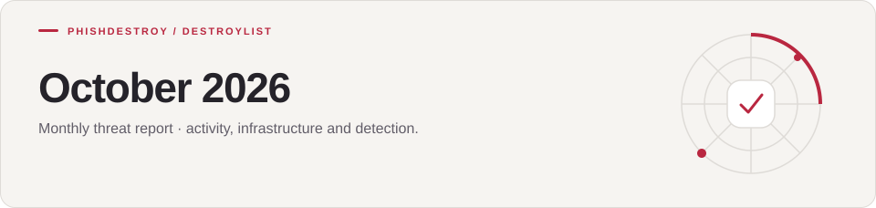
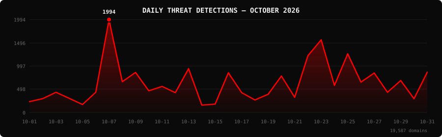

<!--
  PhishDestroy Threat Intelligence Report — October 2026
  19,567 phishing & scam domains detected · Kill rate: 54.6%
  Keywords: phishing report, threat intelligence, 2026-10, destroylist, scam domains, crypto drainer,
  phishing detection, domain blocklist, threat feed, VirusTotal, registrar abuse, brand impersonation,
  cryptocurrency phishing, wallet drainer, monthly security report, cybersecurity analytics
  Canonical: https://github.com/phishdestroy/destroylist/tree/main/rootlist/2026/10
  Previous: https://github.com/phishdestroy/destroylist/tree/main/rootlist/2026/09
  Data: https://github.com/phishdestroy/destroylist/tree/main/rootlist/2026/10/2026-10-threats.json
-->

[**← September 2026**](../../2026/09/) &nbsp;·&nbsp; 📅 **October 2026** &nbsp;·&nbsp; [**November 2026 →**](../../2026/11/)

 

  

  

##  Dashboard

|  |  |  |  |
|:---:|:---:|:---:|:---:|
| **19,567** | **8,843** | **10,652** | **16,612** |

|  |  |  |  |
|:---:|:---:|:---:|:---:|
| **19,062** (97.4%) | **891** | **268.2h** | **225h** |

> Peak: **2026-10-07** (1,994) &nbsp;·&nbsp; Low: **2026-10-14** (159) &nbsp;·&nbsp; Active days: **31**

📊 <b>Daily breakdown</b>

 

| Date | Domains | Activity |
|:-----|--------:|:---------|
| `2026-10-01` | **234** | `██░░░░░░░░░░░░░░░░░░` |
| `2026-10-02` | **298** | `███░░░░░░░░░░░░░░░░░` |
| `2026-10-03` | **435** | `████░░░░░░░░░░░░░░░░` |
| `2026-10-04` | **304** | `███░░░░░░░░░░░░░░░░░` |
| `2026-10-05` | **172** | `██░░░░░░░░░░░░░░░░░░` |
| `2026-10-06` | **436** | `████░░░░░░░░░░░░░░░░` |
| `2026-10-07` | **1,994** | `████████████████████` |
| `2026-10-08` | **661** | `███████░░░░░░░░░░░░░` |
| `2026-10-09` | **861** | `█████████░░░░░░░░░░░` |
| `2026-10-10` | **466** | `█████░░░░░░░░░░░░░░░` |
| `2026-10-11` | **560** | `██████░░░░░░░░░░░░░░` |
| `2026-10-12` | **426** | `████░░░░░░░░░░░░░░░░` |
| `2026-10-13` | **940** | `█████████░░░░░░░░░░░` |
| `2026-10-14` | **159** | `██░░░░░░░░░░░░░░░░░░` |
| `2026-10-15` | **180** | `██░░░░░░░░░░░░░░░░░░` |
| `2026-10-16` | **853** | `█████████░░░░░░░░░░░` |
| `2026-10-17` | **427** | `████░░░░░░░░░░░░░░░░` |
| `2026-10-18` | **270** | `███░░░░░░░░░░░░░░░░░` |
| `2026-10-19` | **392** | `████░░░░░░░░░░░░░░░░` |
| `2026-10-20` | **784** | `████████░░░░░░░░░░░░` |
| `2026-10-21` | **326** | `███░░░░░░░░░░░░░░░░░` |
| `2026-10-22` | **1,220** | `████████████░░░░░░░░` |
| `2026-10-23` | **1,561** | `████████████████░░░░` |
| `2026-10-24` | **581** | `██████░░░░░░░░░░░░░░` |
| `2026-10-25` | **1,260** | `█████████████░░░░░░░` |
| `2026-10-26` | **651** | `███████░░░░░░░░░░░░░` |
| `2026-10-27` | **847** | `████████░░░░░░░░░░░░` |
| `2026-10-28` | **434** | `████░░░░░░░░░░░░░░░░` |
| `2026-10-29` | **686** | `███████░░░░░░░░░░░░░` |
| `2026-10-30` | **294** | `███░░░░░░░░░░░░░░░░░` |
| `2026-10-31` | **855** | `█████████░░░░░░░░░░░` |

##  Intelligence Analysis

### Executive Summary

October 2026 detected **19,567** phishing and scam domains across 31 active days , a **+20%** change from September 2026's 16,250. The kill rate stands at **54.6%**, with 10,652 domains no longer serving content and 8,843 still live. VirusTotal flagged **97.4%** of the month's domains and Google Safe Browsing flagged 891. The leading registrar was Dynadot Inc. with 7,305 domains (37.3%). MetaMask was the most impersonated brand (814 domains).

### Key Trends

- **Volume** — 19,567 domains vs 16,250 in September 2026 (+20%).
- **VirusTotal coverage** — 97.4% vs 99.1% the previous month.
- **Registrars** — Dynadot Inc. ranked #1 with 7,305 domains. New in the top 10: Cloudflare, Inc., Google LLC, Vercel Inc..
- **Domain zones** — `.shop` led with 5,605 domains (28.6%), followed by `.com`, `.app`, `.dev`.
- **Brands** — top targets were MetaMask, Ledger, Paypal. New in the top 10: Paypal, Ethereum, Celer.

### Activity Patterns

Detections peaked on **2026-10-07** with 1,994 domains; the lowest day was 2026-10-14 (159). The daily average was 631 domains. Days below 10% of the peak: 3.

Crypto drainer kits identified this month: Solana Drainer (36), Angel Drainer (33), wallet_drainer (6), Wallet Connect Abuse (1).

### Registrar Accountability

Dynadot Inc. (7,305, 37.3%), NICENIC INTERNATIONAL GROUP CO., LIMITED (2,127, 10.9%), Cloudflare, Inc. (1,038, 5.3%) were the three registrars with the most phishing domains this month.

Top 3 registrars account for **10,470 domains** (53.5% of threats).

### Detection Landscape

alphaMountain.ai (17,367, 88.8%), Gridinsoft (16,155, 82.6%), Forcepoint ThreatSeeker (15,217, 77.8%), SOCRadar (14,892, 76.1%) were the most active VirusTotal engines. Overall, 19,062 of 19,567 domains (97.4%) had at least one VirusTotal detection.

### Recommendations

- **For Security Teams** — Subscribe to the destroylist feeds and block on VirusTotal consensus; 97.4% of this month's domains are already flagged.
- **For SOC Analysts** — Prioritise domains registered with Dynadot Inc. in the `.shop` zone, the highest-volume combination this month.
- **For Registrars** — Dynadot Inc. and NICENIC INTERNATIONAL GROUP CO., LIMITED hold the largest share of reported domains; faster abuse handling would have the biggest impact.
- **For Brand Owners** — MetaMask, Ledger, Paypal should monitor for look-alike registrations.
- **For End Users** — Check unfamiliar crypto and login links at [api.destroy.tools](https://api.destroy.tools/v1/check?domain=example.com) before connecting a wallet.

##  Top Registrars

| # | Registrar | Domains | Share | Trend |
|:--:|:---|------:|:---|:---:|
| **1** | Dynadot Inc. | **7,305** | `██████░░░░░░░░░` 37.3% | 🔺 |
| **2** | NICENIC INTERNATIONAL GROUP CO., LIMITED | **2,127** | `██░░░░░░░░░░░░░` 10.9% | 🔺 |
| **3** | Cloudflare, Inc. | **1,038** | `█░░░░░░░░░░░░░░` 5.3% | 🆕 |
| **4** | Spaceship, Inc. | **945** | `█░░░░░░░░░░░░░░` 4.8% | 🔺 |
| **5** | Google LLC | **483** | `░░░░░░░░░░░░░░░` 2.5% | 🆕 |
| **6** | Vercel Inc. | **473** | `░░░░░░░░░░░░░░░` 2.4% | 🆕 |
| **7** | NameSilo, LLC | **441** | `░░░░░░░░░░░░░░░` 2.3% | 🔺 |
| **8** | Gname.com Pte. Ltd. | **360** | `░░░░░░░░░░░░░░░` 1.8% | 🆕 |
| **9** | GitHub, Inc. | **359** | `░░░░░░░░░░░░░░░` 1.8% | 🆕 |
| **10** | GoDaddy.com, LLC | **302** | `░░░░░░░░░░░░░░░` 1.5% | 🔻 |

> ⚠️ Top 3 registrars = **10,470** domains (53.5% of all threats)

##  Domain Zones

| # | TLD | Domains | Share | vs Prev |
|:--:|:---|------:|------:|:---:|
| **1** | `.shop` | **5,605** | 28.6% | 🔺 |
| **2** | `.com` | **5,396** | 27.6% | 🔻 |
| **3** | `.app` | **1,227** | 6.3% | 🔺 |
| **4** | `.dev` | **912** | 4.7% | 🔻 |
| **5** | `.net` | **894** | 4.6% | 🔺 |
| **6** | `.xyz` | **602** | 3.1% | 🔺 |
| **7** | `.io` | **459** | 2.3% | 🔻 |
| **8** | `.org` | **359** | 1.8% | 🔺 |
| **9** | `.live` | **277** | 1.4% | 🔻 |
| **10** | `.cn` | **251** | 1.3% | 🆕 |

##  Registrar Geography

| # | Country | Domains | Share |
|:--:|:---|------:|------:|
| **1** | Unknown | **11,628** | 59.4% |
| **2** | US | **4,371** | 22.3% |
| **3** | UNKNOWN | **1,020** | 5.2% |
| **4** | HK | **910** | 4.7% |
| **5** | CN | **197** | 1.0% |
| **6** | GB | **120** | 0.6% |
| **7** | SG | **117** | 0.6% |
| **8** | NL | **115** | 0.6% |
| **9** | KH | **74** | 0.4% |
| **10** | DE | **69** | 0.4% |

##  Targeted Brands

| # | Brand | Domains | Share |
|:--:|:---|------:|------:|
| **1** | MetaMask | **814** | 4.2% |
| **2** | Ledger | **473** | 2.4% |
| **3** | Paypal | **455** | 2.3% |
| **4** | Google | **407** | 2.1% |
| **5** | Ethereum | **397** | 2.0% |
| **6** | Celer | **396** | 2.0% |
| **7** | Apple | **337** | 1.7% |
| **8** | Binance | **227** | 1.2% |
| **9** | Signal | **202** | 1.0% |
| **10** | Facebook | **169** | 0.9% |

##  Crypto Drainers & Kits

| # | Type | Domains |
|:--:|:---|------:|
| **1** | Solana Drainer | **36** |
| **2** | Angel Drainer | **33** |
| **3** | wallet_drainer | **6** |
| **4** | Wallet Connect Abuse | **1** |

##  Detection Engines (VirusTotal)

| # | Engine | Detections | Coverage |
|:--:|:---|------:|------:|
| **1** | alphaMountain.ai | **17,367** | 88.8% |
| **2** | Gridinsoft | **16,155** | 82.6% |
| **3** | Forcepoint ThreatSeeker | **15,217** | 77.8% |
| **4** | SOCRadar | **14,892** | 76.1% |
| **5** | Fortinet | **12,384** | 63.3% |
| **6** | G-Data | **11,243** | 57.5% |
| **7** | CRDF | **10,828** | 55.3% |
| **8** | BitDefender | **9,762** | 49.9% |
| **9** | VIPRE | **8,917** | 45.6% |
| **10** | ESET | **8,611** | 44.0% |
| **11** | Sophos | **7,797** | 39.8% |
| **12** | Lionic | **7,113** | 36.4% |
| **13** | Kaspersky | **6,846** | 35.0% |
| **14** | Webroot | **6,779** | 34.6% |
| **15** | LevelBlue | **6,777** | 34.6% |

>  &nbsp; 

##  Downloads & Data

| Format | File | Description |
|:-------|:-----|:------------|
| 📋 Report | [`README.md`](.) | This report |
| 🗃️ Threats | [`2026-10-threats.json`](2026-10-threats.json) | **19,567** threats with registrars, IPs, VT vendors |
| 📈 Chart | [`2026-10-activity.svg`](2026-10-activity.svg) | Daily detection activity graph |

> 💡 **API access**: Query any domain at [`api.destroy.tools/v1/check`](https://api.destroy.tools/v1/check?domain=example.com) — free, no API key

##  All Reports

| Report | Domains |
|:-------|--------:|
| [January 2025](../../2025/01/) | **1** |
| [February 2025](../../2025/02/) | **13** |
| [March 2025](../../2025/03/) | **2** |
| [April 2025](../../2025/04/) | **2** |
| [May 2025](../../2025/05/) | **2** |
| [June 2025](../../2025/06/) | **4** |
| [July 2025](../../2025/07/) | **700** |
| [August 2025](../../2025/08/) | **3,788** |
| [September 2025](../../2025/09/) | **7,307** |
| [October 2025](../../2025/10/) | **8,841** |
| [November 2025](../../2025/11/) | **12,581** |
| [December 2025](../../2025/12/) | **11,773** |
| [January 2026](../../2026/01/) | **8,932** |
| [February 2026](../../2026/02/) | **18,207** |
| [March 2026](../../2026/03/) | **4,042** |
| [April 2026](../../2026/04/) | **15,633** |
| [May 2026](../../2026/05/) | **7,021** |
| [June 2026](../../2026/06/) | **8,101** |
| [July 2026](../../2026/07/) | **19,796** |
| [August 2026](../../2026/08/) | **19,782** |
| [September 2026](../../2026/09/) | **16,250** |
| 📍 **October 2026** | **19,567** |
| [November 2026](../../2026/11/) | **1,158** |

[**← September 2026**](../../2026/09/) &nbsp;·&nbsp; 📅 **October 2026** &nbsp;·&nbsp; [**November 2026 →**](../../2026/11/)

 

 

Data: [destroylist](https://github.com/phishdestroy/destroylist)

