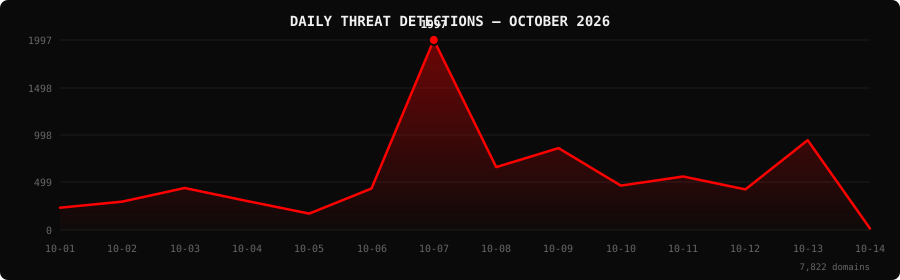

<!--
  PhishDestroy Threat Intelligence Report — October 2026
  8,469 phishing & scam domains detected · Kill rate: 34.5%
  Keywords: phishing report, threat intelligence, 2026-10, destroylist, scam domains, crypto drainer,
  phishing detection, domain blocklist, threat feed, VirusTotal, registrar abuse, brand impersonation,
  cryptocurrency phishing, wallet drainer, monthly security report, cybersecurity analytics
  Canonical: https://github.com/phishdestroy/destroylist/tree/main/rootlist/2026/10
  Previous: https://github.com/phishdestroy/destroylist/tree/main/rootlist/2026/09
  Data: https://github.com/phishdestroy/destroylist/tree/main/rootlist/2026/10/2026-10-threats.json
-->

[**← September 2026**](../../2026/09/) &nbsp;·&nbsp; 📅 **October 2026** &nbsp;·&nbsp; *ongoing...*

 

  

  

##  Dashboard

|  |  |  |  |
|:---:|:---:|:---:|:---:|
| **8,469** | **5,460** | **2,871** | **8,375** |

|  |  |  |  |
|:---:|:---:|:---:|:---:|
| **7,870** (92.9%) | **194** | **118.6h** | **108h** |

> Peak: **2026-10-07** (1,995) &nbsp;·&nbsp; Low: **2026-10-14** (159) &nbsp;·&nbsp; Active days: **16** *(month ongoing)*

📊 <b>Daily breakdown</b>

 

| Date | Domains | Activity |
|:-----|--------:|:---------|
| `2026-10-01` | **234** | `██░░░░░░░░░░░░░░░░░░` |
| `2026-10-02` | **298** | `███░░░░░░░░░░░░░░░░░` |
| `2026-10-03` | **435** | `████░░░░░░░░░░░░░░░░` |
| `2026-10-04` | **305** | `███░░░░░░░░░░░░░░░░░` |
| `2026-10-05` | **172** | `██░░░░░░░░░░░░░░░░░░` |
| `2026-10-06` | **436** | `████░░░░░░░░░░░░░░░░` |
| `2026-10-07` | **1,995** | `████████████████████` |
| `2026-10-08` | **661** | `███████░░░░░░░░░░░░░` |
| `2026-10-09` | **861** | `█████████░░░░░░░░░░░` |
| `2026-10-10` | **467** | `█████░░░░░░░░░░░░░░░` |
| `2026-10-11` | **562** | `██████░░░░░░░░░░░░░░` |
| `2026-10-12` | **427** | `████░░░░░░░░░░░░░░░░` |
| `2026-10-13` | **942** | `█████████░░░░░░░░░░░` |
| `2026-10-14` | **159** | `██░░░░░░░░░░░░░░░░░░` |
| `2026-10-15` | **181** | `██░░░░░░░░░░░░░░░░░░` |
| `2026-10-16` | **334** | `███░░░░░░░░░░░░░░░░░` |

##  Intelligence Analysis

### Executive Summary

October 2026 has detected **8,469** phishing and scam domains across 16 active days *(month ongoing as of 2026-10-16)*; at 529 domains per day that is a **-2%** change in daily volume from September 2026 (542 per day). The kill rate stands at **34.5%**, with 2,871 domains no longer serving content and 5,460 still live. VirusTotal flagged **92.9%** of the month's domains and Google Safe Browsing flagged 194. The leading registrar was Dynadot Inc. with 4,039 domains (47.7%). MetaMask was the most impersonated brand (736 domains).

### Key Trends

- **Volume** — 8,469 domains in 16 days so far; daily volume -2% vs September 2026.
- **VirusTotal coverage** — 92.9% vs 99.1% the previous month.
- **Registrars** — Dynadot Inc. ranked #1 with 4,039 domains. New in the top 10: Gname.com Pte. Ltd., DYNADOT LLC, Dominet (HK) Limited.
- **Domain zones** — `.shop` led with 3,777 domains (44.6%), followed by `.com`, `.xyz`, `.net`.
- **Brands** — top targets were MetaMask, Across, Google. New in the top 10: Base, Ethereum, Aave.

### Activity Patterns

Detections peaked on **2026-10-07** with 1,995 domains; the lowest day was 2026-10-14 (159). The daily average was 529 domains. Days below 10% of the peak: 3.

Crypto drainer kits identified this month: Angel Drainer (33), Solana Drainer (30), Wallet Connect Abuse (1).

### Registrar Accountability

Dynadot Inc. (4,039, 47.7%), NICENIC INTERNATIONAL GROUP CO., LIMITED (1,227, 14.5%), Spaceship, Inc. (269, 3.2%) were the three registrars with the most phishing domains this month.

Top 3 registrars account for **5,535 domains** (65.4% of threats).

### Detection Landscape

alphaMountain.ai (6,953, 82.1%), Gridinsoft (6,890, 81.4%), Forcepoint ThreatSeeker (5,698, 67.3%), SOCRadar (4,923, 58.1%) were the most active VirusTotal engines. Overall, 7,870 of 8,469 domains (92.9%) had at least one VirusTotal detection.

### Recommendations

- **For Security Teams** — Subscribe to the destroylist feeds and block on VirusTotal consensus; 92.9% of this month's domains are already flagged.
- **For SOC Analysts** — Prioritise domains registered with Dynadot Inc. in the `.shop` zone, the highest-volume combination this month.
- **For Registrars** — Dynadot Inc. and NICENIC INTERNATIONAL GROUP CO., LIMITED hold the largest share of reported domains; faster abuse handling would have the biggest impact.
- **For Brand Owners** — MetaMask, Across, Google should monitor for look-alike registrations.
- **For End Users** — Check unfamiliar crypto and login links at [api.destroy.tools](https://api.destroy.tools/v1/check?domain=example.com) before connecting a wallet.

##  Top Registrars

| # | Registrar | Domains | Share | Trend |
|:--:|:---|------:|:---|:---:|
| **1** | Dynadot Inc. | **4,039** | `███████░░░░░░░░` 47.7% | 🔺 |
| **2** | NICENIC INTERNATIONAL GROUP CO., LIMITED | **1,227** | `██░░░░░░░░░░░░░` 14.5% | 🔺 |
| **3** | Spaceship, Inc. | **269** | `░░░░░░░░░░░░░░░` 3.2% | 🔻 |
| **4** | NameSilo, LLC | **247** | `░░░░░░░░░░░░░░░` 2.9% | 🔻 |
| **5** | Gname.com Pte. Ltd. | **206** | `░░░░░░░░░░░░░░░` 2.4% | 🆕 |
| **6** | GoDaddy.com, LLC | **149** | `░░░░░░░░░░░░░░░` 1.8% | 🔻 |
| **7** | DYNADOT LLC | **142** | `░░░░░░░░░░░░░░░` 1.7% | 🆕 |
| **8** | Global Domain Group LLC | **114** | `░░░░░░░░░░░░░░░` 1.3% | 🔻 |
| **9** | Dominet (HK) Limited | **111** | `░░░░░░░░░░░░░░░` 1.3% | 🆕 |
| **10** | Cloudflare, Inc. | **106** | `░░░░░░░░░░░░░░░` 1.3% | 🆕 |

> ⚠️ Top 3 registrars = **5,535** domains (65.4% of all threats)

##  Domain Zones

| # | TLD | Domains | Share | vs Prev |
|:--:|:---|------:|------:|:---:|
| **1** | `.shop` | **3,777** | 44.6% | 🔺 |
| **2** | `.com` | **1,958** | 23.1% | 🔻 |
| **3** | `.xyz` | **472** | 5.6% | 🔺 |
| **4** | `.net` | **249** | 2.9% | 🔻 |
| **5** | `.org` | **131** | 1.5% | 🔻 |
| **6** | `.app` | **116** | 1.4% | 🔻 |
| **7** | `.live` | **115** | 1.4% | 🔻 |
| **8** | `.cfd` | **99** | 1.2% | 🆕 |
| **9** | `.cc` | **89** | 1.1% | 🔻 |
| **10** | `.icu` | **81** | 1.0% | 🆕 |

##  Registrar Geography

| # | Country | Domains | Share |
|:--:|:---|------:|------:|
| **1** | US | **3,680** | 43.5% |
| **2** | Unknown | **1,859** | 22.0% |
| **3** | UNKNOWN | **1,020** | 12.0% |
| **4** | HK | **855** | 10.1% |
| **5** | CN | **116** | 1.4% |
| **6** | NL | **96** | 1.1% |
| **7** | SG | **81** | 1.0% |
| **8** | GB | **80** | 0.9% |
| **9** | KH | **69** | 0.8% |
| **10** | EE | **68** | 0.8% |

##  Targeted Brands

| # | Brand | Domains | Share |
|:--:|:---|------:|------:|
| **1** | MetaMask | **736** | 8.7% |
| **2** | Across | **460** | 5.4% |
| **3** | Google | **310** | 3.7% |
| **4** | Apple | **235** | 2.8% |
| **5** | Base | **104** | 1.2% |
| **6** | Ledger | **78** | 0.9% |
| **7** | Facebook | **72** | 0.9% |
| **8** | Investment Scam | **69** | 0.8% |
| **9** | Ethereum | **63** | 0.7% |
| **10** | Aave | **63** | 0.7% |

##  Crypto Drainers & Kits

| # | Type | Domains |
|:--:|:---|------:|
| **1** | Angel Drainer | **33** |
| **2** | Solana Drainer | **30** |
| **3** | Wallet Connect Abuse | **1** |

##  Detection Engines (VirusTotal)

| # | Engine | Detections | Coverage |
|:--:|:---|------:|------:|
| **1** | alphaMountain.ai | **6,953** | 82.1% |
| **2** | Gridinsoft | **6,890** | 81.4% |
| **3** | Forcepoint ThreatSeeker | **5,698** | 67.3% |
| **4** | SOCRadar | **4,923** | 58.1% |
| **5** | CRDF | **4,760** | 56.2% |
| **6** | Fortinet | **4,246** | 50.1% |
| **7** | G-Data | **3,875** | 45.8% |
| **8** | LevelBlue | **3,335** | 39.4% |
| **9** | BitDefender | **3,116** | 36.8% |
| **10** | Netcraft | **2,894** | 34.2% |
| **11** | ESET | **2,523** | 29.8% |
| **12** | Webroot | **2,324** | 27.4% |
| **13** | Sophos | **1,761** | 20.8% |
| **14** | VIPRE | **1,757** | 20.7% |
| **15** | Kaspersky | **1,579** | 18.6% |

>  &nbsp; 

##  Downloads & Data

| Format | File | Description |
|:-------|:-----|:------------|
| 📋 Report | [`README.md`](.) | This report |
| 🗃️ Threats | [`2026-10-threats.json`](2026-10-threats.json) | **8,469** threats with registrars, IPs, VT vendors |
| 📈 Chart | [`2026-10-activity.svg`](2026-10-activity.svg) | Daily detection activity graph |

> 💡 **API access**: Query any domain at [`api.destroy.tools/v1/check`](https://api.destroy.tools/v1/check?domain=example.com) — free, no API key

##  All Reports

| Report | Domains |
|:-------|--------:|
| [January 2025](../../2025/01/) | **1** |
| [February 2025](../../2025/02/) | **13** |
| [March 2025](../../2025/03/) | **2** |
| [April 2025](../../2025/04/) | **2** |
| [May 2025](../../2025/05/) | **2** |
| [June 2025](../../2025/06/) | **4** |
| [July 2025](../../2025/07/) | **700** |
| [August 2025](../../2025/08/) | **3,788** |
| [September 2025](../../2025/09/) | **7,307** |
| [October 2025](../../2025/10/) | **8,841** |
| [November 2025](../../2025/11/) | **12,581** |
| [December 2025](../../2025/12/) | **11,773** |
| [January 2026](../../2026/01/) | **8,932** |
| [February 2026](../../2026/02/) | **18,207** |
| [March 2026](../../2026/03/) | **4,042** |
| [April 2026](../../2026/04/) | **15,633** |
| [May 2026](../../2026/05/) | **7,021** |
| [June 2026](../../2026/06/) | **8,101** |
| [July 2026](../../2026/07/) | **19,796** |
| [August 2026](../../2026/08/) | **19,782** |
| [September 2026](../../2026/09/) | **16,250** |
| 📍 **October 2026** | **8,469** *(ongoing)* |

[**← September 2026**](../../2026/09/) &nbsp;·&nbsp; 📅 **October 2026** &nbsp;·&nbsp; *ongoing...*

 

 

Data: [destroylist](https://github.com/phishdestroy/destroylist)

