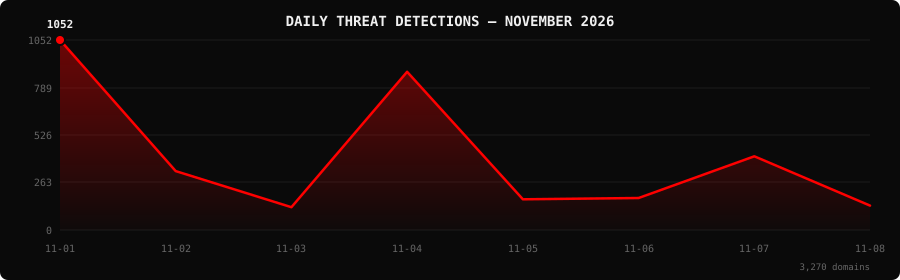

<!--
  PhishDestroy Threat Intelligence Report — November 2026
  4,733 phishing & scam domains detected · Kill rate: 35.0%
  Keywords: phishing report, threat intelligence, 2026-11, destroylist, scam domains, crypto drainer,
  phishing detection, domain blocklist, threat feed, VirusTotal, registrar abuse, brand impersonation,
  cryptocurrency phishing, wallet drainer, monthly security report, cybersecurity analytics
  Canonical: https://github.com/phishdestroy/destroylist/tree/main/rootlist/2026/11
  Previous: https://github.com/phishdestroy/destroylist/tree/main/rootlist/2026/10
  Data: https://github.com/phishdestroy/destroylist/tree/main/rootlist/2026/11/2026-11-threats.json
-->

[**← October 2026**](../../2026/10/) &nbsp;·&nbsp; 📅 **November 2026** &nbsp;·&nbsp; *ongoing...*

 

  

  

##  Dashboard

|  |  |  |  |
|:---:|:---:|:---:|:---:|
| **4,733** | **2,909** | **1,568** | **3,517** |

|  |  |  |  |
|:---:|:---:|:---:|:---:|
| **4,594** (97.1%) | **210** | **57.9h** | **41h** |

> Peak: **2026-11-01** (1,052) &nbsp;·&nbsp; Low: **2026-11-12** (77) &nbsp;·&nbsp; Active days: **12** *(month ongoing)*

📊 <b>Daily breakdown</b>

 

| Date | Domains | Activity |
|:-----|--------:|:---------|
| `2026-11-01` | **1,052** | `████████████████████` |
| `2026-11-02` | **326** | `██████░░░░░░░░░░░░░░` |
| `2026-11-03` | **126** | `██░░░░░░░░░░░░░░░░░░` |
| `2026-11-04` | **876** | `█████████████████░░░` |
| `2026-11-05` | **170** | `███░░░░░░░░░░░░░░░░░` |
| `2026-11-06` | **177** | `███░░░░░░░░░░░░░░░░░` |
| `2026-11-07` | **408** | `████████░░░░░░░░░░░░` |
| `2026-11-08` | **477** | `█████████░░░░░░░░░░░` |
| `2026-11-09` | **328** | `██████░░░░░░░░░░░░░░` |
| `2026-11-10` | **311** | `██████░░░░░░░░░░░░░░` |
| `2026-11-11` | **405** | `████████░░░░░░░░░░░░` |
| `2026-11-12` | **77** | `█░░░░░░░░░░░░░░░░░░░` |

##  Intelligence Analysis

### Executive Summary

November 2026 has detected **4,733** phishing and scam domains across 12 active days *(month ongoing as of 2026-11-12)*; at 394 domains per day that is a **-38%** change in daily volume from October 2026 (631 per day). The kill rate stands at **35.0%**, with 1,568 domains no longer serving content and 2,909 still live. VirusTotal flagged **97.1%** of the month's domains and Google Safe Browsing flagged 210. The leading registrar was Dynadot Inc with 777 domains (16.4%). Whatsapp was the most impersonated brand (165 domains).

### Key Trends

- **Volume** — 4,733 domains in 12 days so far; daily volume -38% vs October 2026.
- **VirusTotal coverage** — 97.1% vs 97.4% the previous month.
- **Registrars** — Dynadot Inc ranked #1 with 777 domains. New in the top 10: MarkMonitor Inc., GKG.Net, Inc., NameCheap, Inc..
- **Domain zones** — `.com` led with 2,211 domains (46.7%), followed by `.app`, `.shop`, `.dev`.
- **Brands** — top targets were Whatsapp, Celer, Signal. New in the top 10: Whatsapp, Gmail, Ups.

### Activity Patterns

Detections peaked on **2026-11-01** with 1,052 domains; the lowest day was 2026-11-12 (77). The daily average was 394 domains. Days below 10% of the peak: 1.

Crypto drainer kits identified this month: wallet_drainer (1).

### Registrar Accountability

Dynadot Inc (777, 16.4%), MarkMonitor Inc. (673, 14.2%), Spaceship, Inc. (275, 5.8%) were the three registrars with the most phishing domains this month.

Top 3 registrars account for **1,725 domains** (36.4% of threats).

### Detection Landscape

alphaMountain.ai (4,219, 89.1%), Gridinsoft (4,194, 88.6%), SOCRadar (3,884, 82.1%), Fortinet (3,752, 79.3%) were the most active VirusTotal engines. Overall, 4,594 of 4,733 domains (97.1%) had at least one VirusTotal detection.

### Recommendations

- **For Security Teams** — Subscribe to the destroylist feeds and block on VirusTotal consensus; 97.1% of this month's domains are already flagged.
- **For SOC Analysts** — Prioritise domains registered with Dynadot Inc in the `.com` zone, the highest-volume combination this month.
- **For Registrars** — Dynadot Inc and MarkMonitor Inc. hold the largest share of reported domains; faster abuse handling would have the biggest impact.
- **For Brand Owners** — Whatsapp, Celer, Signal should monitor for look-alike registrations.
- **For End Users** — Check unfamiliar crypto and login links at [api.destroy.tools](https://api.destroy.tools/v1/check?domain=example.com) before connecting a wallet.

##  Top Registrars

| # | Registrar | Domains | Share | Trend |
|:--:|:---|------:|:---|:---:|
| **1** | Dynadot Inc | **777** | `██░░░░░░░░░░░░░` 16.4% | 🔻 |
| **2** | MarkMonitor Inc. | **673** | `██░░░░░░░░░░░░░` 14.2% | 🆕 |
| **3** | Spaceship, Inc. | **275** | `█░░░░░░░░░░░░░░` 5.8% | 🔻 |
| **4** | NICENIC INTERNATIONAL GROUP CO., LIMITED | **210** | `█░░░░░░░░░░░░░░` 4.4% | 🔻 |
| **5** | Google LLC | **175** | `█░░░░░░░░░░░░░░` 3.7% | 🔻 |
| **6** | GKG.Net, Inc. | **173** | `█░░░░░░░░░░░░░░` 3.7% | 🆕 |
| **7** | NameCheap, Inc. | **159** | `█░░░░░░░░░░░░░░` 3.4% | 🆕 |
| **8** | MainReg Inc. | **142** | `░░░░░░░░░░░░░░░` 3.0% | 🆕 |
| **9** | Square, Inc. | **140** | `░░░░░░░░░░░░░░░` 3.0% | 🆕 |
| **10** | Cloudflare, Inc. | **136** | `░░░░░░░░░░░░░░░` 2.9% | 🔻 |

> ⚠️ Top 3 registrars = **1,725** domains (36.4% of all threats)

##  Domain Zones

| # | TLD | Domains | Share | vs Prev |
|:--:|:---|------:|------:|:---:|
| **1** | `.com` | **2,211** | 46.7% | 🔻 |
| **2** | `.app` | **561** | 11.9% | 🔻 |
| **3** | `.shop` | **317** | 6.7% | 🔻 |
| **4** | `.dev` | **167** | 3.5% | 🔻 |
| **5** | `.net` | **154** | 3.3% | 🔻 |
| **6** | `.digital` | **146** | 3.1% | 🆕 |
| **7** | `.click` | **116** | 2.5% | 🆕 |
| **8** | `.pro` | **97** | 2.0% | 🆕 |
| **9** | `.live` | **87** | 1.8% | 🔻 |
| **10** | `.io` | **79** | 1.7% | 🔻 |

##  Registrar Geography

| # | Country | Domains | Share |
|:--:|:---|------:|------:|
| **1** | Unknown | **4,184** | 88.4% |
| **2** | US | **323** | 6.8% |
| **3** | FR | **44** | 0.9% |
| **4** | NL | **29** | 0.6% |
| **5** | CN | **24** | 0.5% |
| **6** | HK | **22** | 0.5% |
| **7** | SG | **15** | 0.3% |
| **8** | GB | **15** | 0.3% |
| **9** | IN | **8** | 0.2% |
| **10** | LT | **6** | 0.1% |

##  Targeted Brands

| # | Brand | Domains | Share |
|:--:|:---|------:|------:|
| **1** | Whatsapp | **165** | 3.5% |
| **2** | Celer | **61** | 1.3% |
| **3** | Signal | **51** | 1.1% |
| **4** | Google | **45** | 1.0% |
| **5** | Gmail | **43** | 0.9% |
| **6** | Ups | **38** | 0.8% |
| **7** | Cloudflare | **38** | 0.8% |
| **8** | Microsoft | **32** | 0.7% |
| **9** | Ledger | **32** | 0.7% |
| **10** | Paypal | **31** | 0.7% |

##  Crypto Drainers & Kits

| # | Type | Domains |
|:--:|:---|------:|
| **1** | wallet_drainer | **1** |

##  Detection Engines (VirusTotal)

| # | Engine | Detections | Coverage |
|:--:|:---|------:|------:|
| **1** | alphaMountain.ai | **4,219** | 89.1% |
| **2** | Gridinsoft | **4,194** | 88.6% |
| **3** | SOCRadar | **3,884** | 82.1% |
| **4** | Fortinet | **3,752** | 79.3% |
| **5** | VIPRE | **3,669** | 77.5% |
| **6** | G-Data | **3,583** | 75.7% |
| **7** | BitDefender | **3,523** | 74.4% |
| **8** | Forcepoint ThreatSeeker | **3,520** | 74.4% |
| **9** | Sophos | **3,466** | 73.2% |
| **10** | Lionic | **3,458** | 73.1% |
| **11** | ESET | **3,388** | 71.6% |
| **12** | DNS8 | **2,899** | 61.3% |
| **13** | CyRadar | **2,465** | 52.1% |
| **14** | Webroot | **2,444** | 51.6% |
| **15** | Seclookup | **2,412** | 51.0% |

>  &nbsp; 

##  Downloads & Data

| Format | File | Description |
|:-------|:-----|:------------|
| 📋 Report | [`README.md`](.) | This report |
| 🗃️ Threats | [`2026-11-threats.json`](2026-11-threats.json) | **4,733** threats with registrars, IPs, VT vendors |
| 📈 Chart | [`2026-11-activity.svg`](2026-11-activity.svg) | Daily detection activity graph |

> 💡 **API access**: Query any domain at [`api.destroy.tools/v1/check`](https://api.destroy.tools/v1/check?domain=example.com) — free, no API key

##  All Reports

| Report | Domains |
|:-------|--------:|
| [January 2025](../../2025/01/) | **1** |
| [February 2025](../../2025/02/) | **13** |
| [March 2025](../../2025/03/) | **2** |
| [April 2025](../../2025/04/) | **2** |
| [May 2025](../../2025/05/) | **2** |
| [June 2025](../../2025/06/) | **4** |
| [July 2025](../../2025/07/) | **700** |
| [August 2025](../../2025/08/) | **3,788** |
| [September 2025](../../2025/09/) | **7,307** |
| [October 2025](../../2025/10/) | **8,841** |
| [November 2025](../../2025/11/) | **12,581** |
| [December 2025](../../2025/12/) | **11,773** |
| [January 2026](../../2026/01/) | **8,932** |
| [February 2026](../../2026/02/) | **18,207** |
| [March 2026](../../2026/03/) | **4,042** |
| [April 2026](../../2026/04/) | **15,633** |
| [May 2026](../../2026/05/) | **7,021** |
| [June 2026](../../2026/06/) | **8,101** |
| [July 2026](../../2026/07/) | **19,796** |
| [August 2026](../../2026/08/) | **19,782** |
| [September 2026](../../2026/09/) | **16,250** |
| [October 2026](../../2026/10/) | **19,567** |
| 📍 **November 2026** | **4,733** *(ongoing)* |

[**← October 2026**](../../2026/10/) &nbsp;·&nbsp; 📅 **November 2026** &nbsp;·&nbsp; *ongoing...*

 

 

Data: [destroylist](https://github.com/phishdestroy/destroylist)

