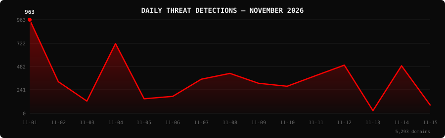

<!--
  PhishDestroy Threat Intelligence Report — November 2026
  9,287 phishing & scam domains detected · Kill rate: 39.5%
  Keywords: phishing report, threat intelligence, 2026-11, destroylist, scam domains, crypto drainer,
  phishing detection, domain blocklist, threat feed, VirusTotal, registrar abuse, brand impersonation,
  cryptocurrency phishing, wallet drainer, monthly security report, cybersecurity analytics
  Canonical: https://github.com/phishdestroy/destroylist/tree/main/rootlist/2026/11
  Previous: https://github.com/phishdestroy/destroylist/tree/main/rootlist/2026/10
  Data: https://github.com/phishdestroy/destroylist/tree/main/rootlist/2026/11/2026-11-threats.json
-->

[**← October 2026**](../../2026/10/) &nbsp;·&nbsp; 📅 **November 2026** &nbsp;·&nbsp; *ongoing...*

 

  

  

##  Dashboard

|  |  |  |  |
|:---:|:---:|:---:|:---:|
| **9,287** | **5,165** | **3,369** | **7,850** |

|  |  |  |  |
|:---:|:---:|:---:|:---:|
| **8,898** (95.8%) | **589** | **375.2h** | **127h** |

> Peak: **2026-11-16** (1,459) &nbsp;·&nbsp; Low: **2026-11-13** (28) &nbsp;·&nbsp; Active days: **23** *(month ongoing)*

📊 <b>Daily breakdown</b>

 

| Date | Domains | Activity |
|:-----|--------:|:---------|
| `2026-11-01` | **962** | `█████████████░░░░░░░` |
| `2026-11-02` | **326** | `████░░░░░░░░░░░░░░░░` |
| `2026-11-03` | **126** | `██░░░░░░░░░░░░░░░░░░` |
| `2026-11-04` | **716** | `██████████░░░░░░░░░░` |
| `2026-11-05` | **150** | `██░░░░░░░░░░░░░░░░░░` |
| `2026-11-06` | **175** | `██░░░░░░░░░░░░░░░░░░` |
| `2026-11-07` | **351** | `█████░░░░░░░░░░░░░░░` |
| `2026-11-08` | **409** | `██████░░░░░░░░░░░░░░` |
| `2026-11-09` | **309** | `████░░░░░░░░░░░░░░░░` |
| `2026-11-10` | **278** | `████░░░░░░░░░░░░░░░░` |
| `2026-11-11` | **387** | `█████░░░░░░░░░░░░░░░` |
| `2026-11-12` | **496** | `███████░░░░░░░░░░░░░` |
| `2026-11-13` | **28** | `░░░░░░░░░░░░░░░░░░░░` |
| `2026-11-14` | **489** | `███████░░░░░░░░░░░░░` |
| `2026-11-15` | **114** | `██░░░░░░░░░░░░░░░░░░` |
| `2026-11-16` | **1,459** | `████████████████████` |
| `2026-11-17` | **566** | `████████░░░░░░░░░░░░` |
| `2026-11-18` | **1,002** | `██████████████░░░░░░` |
| `2026-11-19` | **119** | `██░░░░░░░░░░░░░░░░░░` |
| `2026-11-20` | **215** | `███░░░░░░░░░░░░░░░░░` |
| `2026-11-21` | **267** | `████░░░░░░░░░░░░░░░░` |
| `2026-11-22` | **209** | `███░░░░░░░░░░░░░░░░░` |
| `2026-11-23` | **134** | `██░░░░░░░░░░░░░░░░░░` |

##  Intelligence Analysis

### Executive Summary

November 2026 has detected **9,287** phishing and scam domains across 23 active days *(month ongoing as of 2026-11-23)*; at 404 domains per day that is a **-36%** change in daily volume from October 2026 (631 per day). The kill rate stands at **39.5%**, with 3,369 domains no longer serving content and 5,165 still live. VirusTotal flagged **95.8%** of the month's domains and Google Safe Browsing flagged 589. The leading registrar was Dynadot Inc with 1,175 domains (12.7%). Ledger was the most impersonated brand (362 domains).

### Key Trends

- **Volume** — 9,287 domains in 23 days so far; daily volume -36% vs October 2026.
- **VirusTotal coverage** — 95.8% vs 97.4% the previous month.
- **Registrars** — Dynadot Inc ranked #1 with 1,175 domains. New in the top 10: NameCheap, Inc., GKG.Net, Inc., MainReg Inc..
- **Domain zones** — `.com` led with 3,450 domains (37.1%), followed by `.app`, `.shop`, `.dev`.
- **Brands** — top targets were Ledger, Whatsapp, Facebook. New in the top 10: Whatsapp, Microsoft, ShopeePay.

### Activity Patterns

Detections peaked on **2026-11-16** with 1,459 domains; the lowest day was 2026-11-13 (28). The daily average was 404 domains. Days below 10% of the peak: 5.

Crypto drainer kits identified this month: wallet_drainer (1).

### Registrar Accountability

Dynadot Inc (1,175, 12.7%), NICENIC INTERNATIONAL GROUP CO., LIMITED (750, 8.1%), Spaceship, Inc. (452, 4.9%) were the three registrars with the most phishing domains this month.

Top 3 registrars account for **2,377 domains** (25.6% of threats).

### Detection Landscape

alphaMountain.ai (7,891, 85.0%), Gridinsoft (7,565, 81.5%), Forcepoint ThreatSeeker (6,925, 74.6%), Fortinet (6,753, 72.7%) were the most active VirusTotal engines. Overall, 8,898 of 9,287 domains (95.8%) had at least one VirusTotal detection.

### Recommendations

- **For Security Teams** — Subscribe to the destroylist feeds and block on VirusTotal consensus; 95.8% of this month's domains are already flagged.
- **For SOC Analysts** — Prioritise domains registered with Dynadot Inc in the `.com` zone, the highest-volume combination this month.
- **For Registrars** — Dynadot Inc and NICENIC INTERNATIONAL GROUP CO., LIMITED hold the largest share of reported domains; faster abuse handling would have the biggest impact.
- **For Brand Owners** — Ledger, Whatsapp, Facebook should monitor for look-alike registrations.
- **For End Users** — Check unfamiliar crypto and login links at [api.destroy.tools](https://api.destroy.tools/v1/check?domain=example.com) before connecting a wallet.

##  Top Registrars

| # | Registrar | Domains | Share | Trend |
|:--:|:---|------:|:---|:---:|
| **1** | Dynadot Inc | **1,175** | `██░░░░░░░░░░░░░` 12.7% | 🔻 |
| **2** | NICENIC INTERNATIONAL GROUP CO., LIMITED | **750** | `█░░░░░░░░░░░░░░` 8.1% | 🔻 |
| **3** | Spaceship, Inc. | **452** | `█░░░░░░░░░░░░░░` 4.9% | 🔻 |
| **4** | NameCheap, Inc. | **282** | `░░░░░░░░░░░░░░░` 3.0% | 🆕 |
| **5** | GKG.Net, Inc. | **197** | `░░░░░░░░░░░░░░░` 2.1% | 🆕 |
| **6** | MainReg Inc. | **177** | `░░░░░░░░░░░░░░░` 1.9% | 🆕 |
| **7** | GoDaddy.com, LLC | **172** | `░░░░░░░░░░░░░░░` 1.9% | 🔻 |
| **8** | NameSilo, LLC | **165** | `░░░░░░░░░░░░░░░` 1.8% | 🔻 |
| **9** | NAMECHEAP INC | **153** | `░░░░░░░░░░░░░░░` 1.6% | 🆕 |
| **10** | Porkbun LLC | **130** | `░░░░░░░░░░░░░░░` 1.4% | 🆕 |

> ⚠️ Top 3 registrars = **2,377** domains (25.6% of all threats)

##  Domain Zones

| # | TLD | Domains | Share | vs Prev |
|:--:|:---|------:|------:|:---:|
| **1** | `.com` | **3,450** | 37.1% | 🔻 |
| **2** | `.app` | **977** | 10.5% | 🔻 |
| **3** | `.shop` | **815** | 8.8% | 🔻 |
| **4** | `.dev` | **729** | 7.8% | 🔻 |
| **5** | `.io` | **483** | 5.2% | 🔺 |
| **6** | `.net` | **241** | 2.6% | 🔻 |
| **7** | `.digital` | **206** | 2.2% | 🆕 |
| **8** | `.click` | **178** | 1.9% | 🆕 |
| **9** | `.live` | **158** | 1.7% | 🔻 |
| **10** | `.pro` | **152** | 1.6% | 🆕 |

##  Registrar Geography

| # | Country | Domains | Share |
|:--:|:---|------:|------:|
| **1** | Unknown | **7,979** | 85.9% |
| **2** | US | **763** | 8.2% |
| **3** | CN | **69** | 0.7% |
| **4** | FR | **64** | 0.7% |
| **5** | HK | **63** | 0.7% |
| **6** | NL | **41** | 0.4% |
| **7** | SG | **30** | 0.3% |
| **8** | GB | **28** | 0.3% |
| **9** | CY | **27** | 0.3% |
| **10** | RS | **25** | 0.3% |

##  Targeted Brands

| # | Brand | Domains | Share |
|:--:|:---|------:|------:|
| **1** | Ledger | **362** | 3.9% |
| **2** | Whatsapp | **186** | 2.0% |
| **3** | Facebook | **111** | 1.2% |
| **4** | Google | **96** | 1.0% |
| **5** | Metamask | **85** | 0.9% |
| **6** | Microsoft | **82** | 0.9% |
| **7** | ShopeePay | **75** | 0.8% |
| **8** | Netflix | **72** | 0.8% |
| **9** | Celer | **65** | 0.7% |
| **10** | Trezor | **63** | 0.7% |

##  Crypto Drainers & Kits

| # | Type | Domains |
|:--:|:---|------:|
| **1** | wallet_drainer | **1** |

##  Detection Engines (VirusTotal)

| # | Engine | Detections | Coverage |
|:--:|:---|------:|------:|
| **1** | alphaMountain.ai | **7,891** | 85.0% |
| **2** | Gridinsoft | **7,565** | 81.5% |
| **3** | Forcepoint ThreatSeeker | **6,925** | 74.6% |
| **4** | Fortinet | **6,753** | 72.7% |
| **5** | SOCRadar | **6,463** | 69.6% |
| **6** | G-Data | **6,167** | 66.4% |
| **7** | VIPRE | **6,109** | 65.8% |
| **8** | BitDefender | **5,954** | 64.1% |
| **9** | ESET | **5,637** | 60.7% |
| **10** | Lionic | **5,547** | 59.7% |
| **11** | Sophos | **5,476** | 59.0% |
| **12** | Webroot | **4,801** | 51.7% |
| **13** | Kaspersky | **4,102** | 44.2% |
| **14** | CyRadar | **3,815** | 41.1% |
| **15** | DNS8 | **3,541** | 38.1% |

>  &nbsp; 

##  Downloads & Data

| Format | File | Description |
|:-------|:-----|:------------|
| 📋 Report | [`README.md`](.) | This report |
| 🗃️ Threats | [`2026-11-threats.json`](2026-11-threats.json) | **9,287** threats with registrars, IPs, VT vendors |
| 📈 Chart | [`2026-11-activity.svg`](2026-11-activity.svg) | Daily detection activity graph |

> 💡 **API access**: Query any domain at [`api.destroy.tools/v1/check`](https://api.destroy.tools/v1/check?domain=example.com) — free, no API key

##  All Reports

| Report | Domains |
|:-------|--------:|
| [January 2025](../../2025/01/) | **1** |
| [February 2025](../../2025/02/) | **13** |
| [March 2025](../../2025/03/) | **2** |
| [April 2025](../../2025/04/) | **2** |
| [May 2025](../../2025/05/) | **2** |
| [June 2025](../../2025/06/) | **4** |
| [July 2025](../../2025/07/) | **700** |
| [August 2025](../../2025/08/) | **3,788** |
| [September 2025](../../2025/09/) | **7,307** |
| [October 2025](../../2025/10/) | **8,841** |
| [November 2025](../../2025/11/) | **12,581** |
| [December 2025](../../2025/12/) | **11,773** |
| [January 2026](../../2026/01/) | **8,932** |
| [February 2026](../../2026/02/) | **18,207** |
| [March 2026](../../2026/03/) | **4,042** |
| [April 2026](../../2026/04/) | **15,633** |
| [May 2026](../../2026/05/) | **7,021** |
| [June 2026](../../2026/06/) | **8,101** |
| [July 2026](../../2026/07/) | **19,796** |
| [August 2026](../../2026/08/) | **19,782** |
| [September 2026](../../2026/09/) | **16,250** |
| [October 2026](../../2026/10/) | **19,567** |
| 📍 **November 2026** | **9,287** *(ongoing)* |

[**← October 2026**](../../2026/10/) &nbsp;·&nbsp; 📅 **November 2026** &nbsp;·&nbsp; *ongoing...*

 

 

Data: [destroylist](https://github.com/phishdestroy/destroylist)

