[Destroylist](../../README.md) / [rootlist](../README.md) / 2026

<h1>
<picture>
  <source media="(max-width: 640px)" srcset="banner-mobile.svg">
  
</picture>
</h1>

Monthly reports from the Destroylist archive.

[Monthly reports](#monthly-reports) · [Year navigation](#year-navigation)

---

 -000000?style=for-the-badge) -CC0000?style=for-the-badge)

## Monthly Reports

| # | Month | Domains | Trend |
|:--:|:------|--------:|:---:|
| 01 | [January 2026](01/) | **8,932** | `█████████░░░░░░░░░░░` |
| 02 | [February 2026](02/) | **18,207** | `██████████████████░░` |
| 03 | [March 2026](03/) | **4,042** | `████░░░░░░░░░░░░░░░░` |
| 04 | [April 2026](04/) | **15,633** | `████████████████░░░░` |
| 05 | [May 2026](05/) | **7,021** | `███████░░░░░░░░░░░░░` |
| 06 | [June 2026](06/) | **8,101** *(1–20 Jun)* | `████████░░░░░░░░░░░░` |
| 07 | [July 2026](07/) | **19,796** | `████████████████████` |
| 08 | [August 2026](08/) | **19,782** | `████████████████████` |
| 09 | [September 2026](09/) | **16,250** | `████████████████░░░░` |
| 10 | [October 2026](10/) | **19,567** | `████████████████████` |
| 11 | [November 2026](11/) | **2,654** *(ongoing)* | `███░░░░░░░░░░░░░░░░░` |

> Peak: **July 2026** — 19,796 domains &nbsp;·&nbsp; Total 2026: **139,985+**

---

## Year Navigation

| Year | Link |
|:-----|:-----|
| [2025](../2025/) | 45,014 domains (12 months) |
| **2026** | 📍 You are here |

---

[Destroylist](../../README.md) · [All feeds](../../README.md#data-feeds) · [Appeals](https://phishdestroy.io/appeals/)
