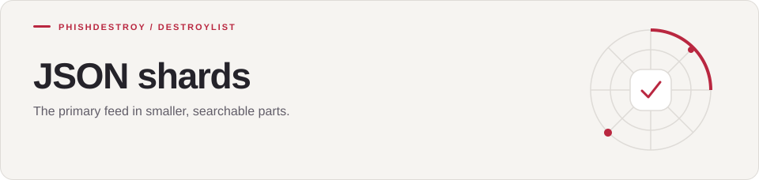

[Destroylist](../../README.md) / [rootlist](../README.md) / arrays

<h1>
<picture>
  <source media="(max-width: 640px)" srcset="banner-mobile.svg">
  
</picture>
</h1>

The primary feed in smaller, searchable parts.

[Format](#format) · [Full primary feed](../../list.json) · [Other formats](../formats/)

---

## Overview

`part_000.json … part_NNN.json` contain the primary list (`list.json`) in sorted order, 3,000 domains per
file. They are rebuilt by `scripts/build_shards.py` whenever the list changes (rootlist, list update and
purge workflows).

> [!TIP]
> `list.json` is too large for GitHub code search; the shards are not. Search any domain across the shards:
> [`repo:phishdestroy/destroylist path:rootlist/arrays example.com`](https://github.com/search?q=repo%3Aphishdestroy%2Fdestroylist+path%3Arootlist%2Farrays+example.com&type=code)

## Format

Each shard is a JSON array of domains:

```json
[
  "0-105.com",
  "0-collab.land",
  "..."
]
```

Concatenating all shards in order gives `list.json`. For feeds in other formats see [`rootlist/formats/`](../formats/).

---

[Destroylist](../../README.md) · [All feeds](../../README.md#data-feeds) · [Appeals](https://phishdestroy.io/appeals/)
