<div align="center">



# Arrays

**The primary list split into small JSON shards**


<p align="center">


</p>


<p align="center">
<a href="https://github.com/phishdestroy/destroylist"></a>
<a href="https://api.destroy.tools"></a>
<a href="https://github.com/phishdestroy/destroylist#data-feeds"></a>
</p>

</div>

---

## Overview

`part_000.json … part_NNN.json` contain the primary list (`list.json`) in sorted order, 3,000 domains per
file. They are rebuilt by `scripts/build_shards.py` whenever the list changes (rootlist, list update and
purge workflows).

> [!TIP]
> `list.json` is too large for GitHub code search; the shards are not. Search any domain across the shards:
> [`repo:phishdestroy/destroylist path:rootlist/arrays example.com`](https://github.com/search?q=repo%3Aphishdestroy%2Fdestroylist+path%3Arootlist%2Farrays+example.com&type=code)

## Format

Each shard is a JSON array of domains:

```json
[
  "0-105.com",
  "0-collab.land",
  "..."
]
```

Concatenating all shards in order gives `list.json`. For feeds in other formats see [`rootlist/formats/`](../formats/).
