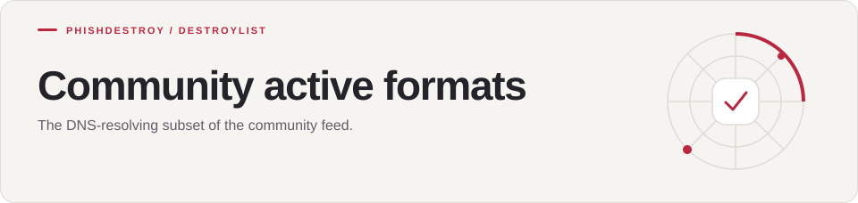

[Destroylist](../../../README.md) / [rootlist](../../README.md) / [formats](../README.md) / community_active

<h1>
<picture>
  <source media="(max-width: 640px)" srcset="banner-mobile.svg">
  
</picture>
</h1>

The DNS-resolving subset of the community feed.

[Downloads](#downloads) · [Compare feeds](../)

---

## Downloads

| Format | Description | Link |
|:-------|:------------|:----:|
| `domains.txt` | Plain domain list | [Download](https://raw.githubusercontent.com/phishdestroy/destroylist/main/rootlist/formats/community_active/domains.txt) |
| `hosts.txt` | Hosts file (`0.0.0.0 domain`) | [Download](https://raw.githubusercontent.com/phishdestroy/destroylist/main/rootlist/formats/community_active/hosts.txt) |
| `adblock.txt` | AdBlock / uBlock Origin filter | [Download](https://raw.githubusercontent.com/phishdestroy/destroylist/main/rootlist/formats/community_active/adblock.txt) |
| `dnsmasq.conf` | DNSMasq / Pi-hole config | [Download](https://raw.githubusercontent.com/phishdestroy/destroylist/main/rootlist/formats/community_active/dnsmasq.conf) |
| `unbound.conf` | Unbound DNS config | [Download](https://raw.githubusercontent.com/phishdestroy/destroylist/main/rootlist/formats/community_active/unbound.conf) |
| `rpz.zone` | Response Policy Zone (BIND) | [Download](https://raw.githubusercontent.com/phishdestroy/destroylist/main/rootlist/formats/community_active/rpz.zone) |
| `redis.txt` | Bulk load into a Redis set | [Download](https://raw.githubusercontent.com/phishdestroy/destroylist/main/rootlist/formats/community_active/redis.txt) |

> Only aggregated domains that currently resolve via DNS.

---

[Destroylist](../../../README.md) · [All feeds](../../../README.md#data-feeds) · [Appeals](https://phishdestroy.io/appeals/)
