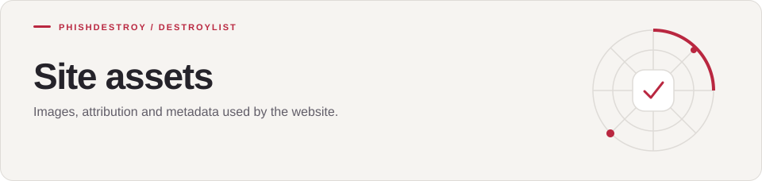

[Destroylist](../../../README.md) / [scripts](../../README.md) / [_source](../README.md) / assets

<h1>
<picture>
  <source media="(max-width: 640px)" srcset="banner-mobile.svg">
  
</picture>
</h1>

Images, attribution and metadata used by the website.

---

Images used by the site generator in [`scripts/_source/`](../). They are embedded into the built page,
so the site makes no third-party image requests.

| Path | Contents |
|:-----|:---------|
| `logos/` | Logos of credited source projects |
| `tool-logos/` | Icons of the community tools directory |
| `logo-manifest.json`, `tool-logo-manifest.json` | Origin of every image |
| `IMAGE-CREDITS.json`, `TOOL-IMAGE-CREDITS.json` | Attribution for every image |
| `metrics-snapshot.json` | Counts shown before live data loads |
| `original-robots.txt`, `original-sitemap.xml` | Templates for `scripts/meta/` |

Logos remain the property of their owners and are used for attribution only.

---

[Destroylist](../../../README.md) · [All feeds](../../../README.md#data-feeds) · [Appeals](https://phishdestroy.io/appeals/)
