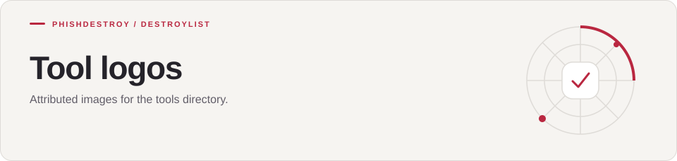

[Destroylist](../../../../README.md) / [scripts](../../../README.md) / [_source](../../README.md) / [assets](../README.md) / tool-logos

<h1>
<picture>
  <source media="(max-width: 640px)" srcset="banner-mobile.svg">
  
</picture>
</h1>

Attributed images for the tools directory.

---

These assets are referenced by [tool-logo-manifest.json](../tool-logo-manifest.json). Attribution is recorded in [TOOL-IMAGE-CREDITS.json](../TOOL-IMAGE-CREDITS.json).
