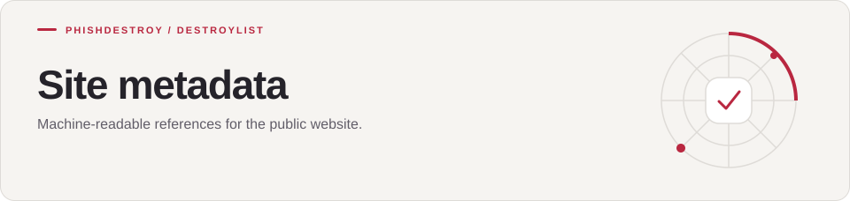

[Destroylist](../../README.md) / [scripts](../README.md) / meta

<h1>
<picture>
  <source media="(max-width: 640px)" srcset="banner-mobile.svg">
  
</picture>
</h1>

Machine-readable references for the public website.

---

Machine-readable files for the website. The Pages workflow copies everything in this folder to the
**site root**, so the public URLs stay short (for example `https://phishdestroy.github.io/destroylist/llms.txt`).

| File | Purpose |
|:-----|:--------|
| `robots.txt`, `sitemap.xml` | Crawler policy and sitemap |
| `llms.txt`, `llms-full.txt` | Project overview for language-model tools |
| `overview.txt` | Plain-text project summary |
| `datasets.json`, `dataset-catalog.jsonld` | Dataset catalog (Schema.org DataCatalog) |
| `sources.json` | Credited upstream sources |
| `tools.json` | Community tools directory |

The JSON and text files are generated by [`scripts/_source/`](../_source/).

---

[Destroylist](../../README.md) · [All feeds](../../README.md#data-feeds) · [Appeals](https://phishdestroy.io/appeals/)
