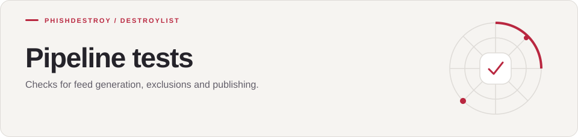

[Destroylist](../../README.md) / [scripts](../README.md) / tests

<h1>
<picture>
  <source media="(max-width: 640px)" srcset="banner-mobile.svg">
  
</picture>
</h1>

Checks for feed generation, exclusions and publishing.

---

Regression tests for the list-maintenance scripts and workflows.

| File | Covers |
|:-----|:-------|
| `test_allowlist_pattern_guard.py` | `scripts/allowlist_pattern_guard.py` and the allowlist guard workflow |
| `test_false_positive_cleanup.py` | Removal of false positives from every published list, archive and daily diff |
| `test_purge_workflow_race.py` | The purge workflow under concurrent pushes |

Run from the repository root:

```bash
pip install -r scripts/requirements.txt pytest
python -m pytest scripts/tests
```

---

[Destroylist](../../README.md) · [All feeds](../../README.md#data-feeds) · [Appeals](https://phishdestroy.io/appeals/)
