<div align="center">



# STIX 2.1 Bundle

**Destroylist phishing domains as STIX 2.1 indicators — ready to import into SIEM and threat-intelligence platforms**


<p align="center">


</p>


<p align="center">
<a href="https://github.com/phishdestroy/destroylist"></a>
<a href="https://api.destroy.tools"></a>
<a href="https://github.com/phishdestroy/destroylist#data-feeds"></a>
</p>

</div>

---

## Overview

`bundle.json` is a single [STIX 2.1](https://oasis-open.github.io/cti-documentation/stix/intro) bundle: one
`identity` object for PhishDestroy and one `indicator` per DNS-verified active domain from
[`dns/active_domains.json`](../dns/), excluding [`allow/allowlist.json`](../allow/allowlist.json).

It is rebuilt twice a day (after DNS validation) and on every allowlist change by
[`stix.yml`](../.github/workflows/stix.yml), and published as an asset of the
[`stix` Release](https://github.com/phishdestroy/destroylist/releases/tag/stix) — not committed, to keep the repository small.

- **Stable objects** — an indicator keeps its `id`, `created` and `valid_from` for as long as the domain stays listed,
  so re-importing the bundle updates rather than duplicates.
- **False positives are revoked** — when a domain is cleared on appeal, its indicator is republished with
  `"revoked": true` (same `id`, new `modified`), so platforms that already imported it retract it.
- Domains that merely stop resolving are left out of the next build.

## Contents

| File | Description |
|:-----|:------------|
| [`bundle.json`](https://github.com/phishdestroy/destroylist/releases/download/stix/bundle.json) | STIX 2.1 bundle — 1 identity + one indicator per active domain + revoked false positives (≈ 64 MB, minified) |

**Indicator example:**

```json
{
  "type": "indicator",
  "spec_version": "2.1",
  "name": "Phishing domain: example-phish.icu",
  "indicator_types": ["malicious-activity"],
  "pattern": "[domain-name:value = 'example-phish.icu']",
  "pattern_type": "stix",
  "labels": ["phishing"],
  "confidence": 85,
  "created_by_ref": "identity--9a8b1427-74d5-4b3e-88a7-b4fa5be17b2c"
}
```

## Use it

- **OpenCTI / MISP / Microsoft Sentinel / Splunk ES** — import `bundle.json` as a STIX 2.1 file; honour `revoked`.
- **Download:** `https://github.com/phishdestroy/destroylist/releases/download/stix/bundle.json`

## Regenerate

```bash
pip install -r scripts/requirements.txt
# --previous keeps ids/dates and revokes allowlisted domains; omit it for a fresh bundle
python scripts/generate_stix.py --previous old-bundle.json --output bundle.json
```
